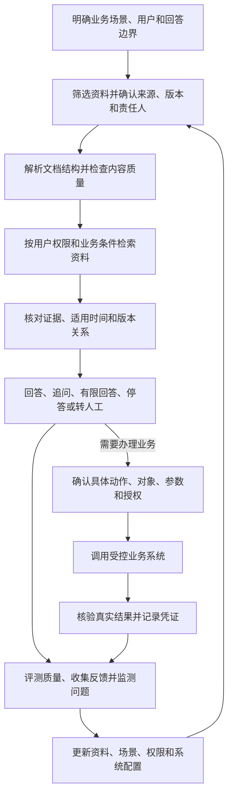

# 全书结语：让知识成为可靠的业务能力

企业建设智能问答，容易从“把资料接进来”开始，也容易把“能生成答案”当成终点。但贯穿全书的核心问题始终是：资料是否值得用于回答，回答是否适用于当前用户和事项，结论有没有可靠依据，以及资料和业务变化后谁来负责。

知识库不是档案仓库，智能体也不是能够替企业承担责任的万能助手。资料数量、模型能力和工具数量，都不能单独证明系统可靠。真正重要的是把业务场景、资料来源、版本关系、权限边界、检索证据、回答方式和维护责任连接起来。

## 一条贯穿全书的实践路线

这条路线不是一次性建设流程。资料更新、权限调整、问题反馈、检索变化和业务规则变更，都可能要求重新检查相关环节。智能体可以帮助理解问题、整理信息和调用工具，但业务授权、专业判断和真实执行结果仍应由相应的系统与责任角色确认。

## 从一个可控场景开始

落地时，不必一开始就追求覆盖所有部门、接入所有资料或开放自动办理。可以先选择一类问题边界清楚、资料来源明确、责任人能够参与、结果便于核验的业务场景；明确哪些问题可以回答、依据来自哪里、什么情况下要追问或停下，再用真实问题检验检索和答案。

运行后，持续记录错答、漏答、旧版本误用、权限拦截、用户反馈和业务操作结果。发现问题时，先定位属于资料、解析、权限、检索、回答还是执行环节，再由对应责任人处理并回归验证。只有当场景效果、维护能力和风险控制都经得起验证，才逐步扩大资料范围或自动化程度。

## 可靠，不是无所不答

成熟的智能问答并不意味着任何问题都能立即给出确定结论。它应当能说明答案依据，识别适用条件，在权限不足、资料冲突或证据不够时采取合适的下一步；如果进一步连接业务操作，也要让用户知道即将发生什么，并以业务系统的真实回执确认结果。

因此，建设企业智能问答的目标，不是让系统看起来无所不知，而是让它在明确的范围内有依据地帮助人，在不确定或越界时及时停下，并让每次变化都有人负责、可以核验、能够改进。知识由此不只是被存放和检索的内容，而成为持续服务业务的一项可靠能力。
