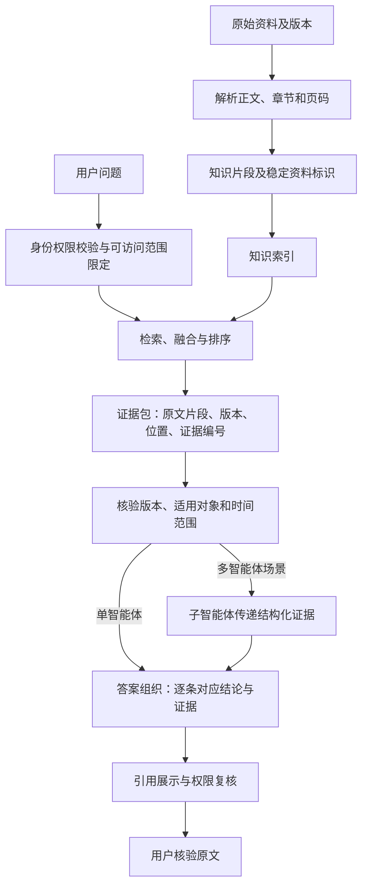

# 第七章 答案可信机制：引用溯源与冲突处理

## 引言：答案后面有个文件名，还不算完成溯源

用户看到一段回答，后面跟着一个文件名，可能会觉得系统已经给出了依据。但真正需要追问时，问题往往是：结论具体由文件哪一部分支持？这个版本适用于哪个单位、哪个时间？引用的原文是否完整？如果答案综合了几份资料，哪份资料支持哪一句话？

如果系统只展示一个标题，却不能定位章节、条款或原文片段，用户仍然需要自己重新翻文件。反过来，引用很多文件也不意味着答案可靠：引用可能只是主题相似，可能引用了旧版本，甚至可能和对应结论没有关系。

因此，“引用”不是回答末尾的装饰，而是答案和证据之间的一条可检查的连接。系统要能说明自己用了哪些资料、从哪里找到相关内容、最终哪条依据支持哪项结论；遇到资料冲突时，还要能够如实呈现，不把不一致的内容拼成一个看似确定的答案。

研究工作也把答案正确性与引用质量分开评估。ALCE 研究基准分别考察回答流畅度、事实正确性和引用质量，并指出带有引用并不自动意味着所有结论都获得了完整支持。[1]

## 一、先区分出处、引用和溯源

这三个词常被混用，实际处在不同层次。

| 概念 | 说明 | 用户能检查什么 |
| --- | --- | --- |
| 出处 | 被系统使用的原始资料及其版本 | 资料是什么、从哪里来 |
| 引用 | 答案中指向资料或片段的标记 | 哪项结论声称依据哪份资料 |
| 溯源 | 从答案回到具体资料位置和处理记录的能力 | 原文位置、版本、上下文，以及引用是否真的支持结论 |

只显示文件名，是提供了一点出处信息；显示文件名和章节，是较好定位；如果还能回到对应原文片段、区分版本并检查支持关系，才更接近可核验的溯源。

企业项目需要的溯源程度，应结合业务风险和使用场景设定。一般性的知识介绍，可能显示资料标题和章节就足够；涉及制度条件、金额标准、合规要求或业务处置时，通常需要提供更精确的条款、原文片段和适用说明。

## 二、把证据链从原始文档一路保存到答案

可追溯的答案不是在生成完成后，再让模型猜一个“可能的出处”。证据关系应在检索过程中建立，并随内容一起传递。

一条完整的证据链大致包括：



权限校验应在受限资料进入可用检索范围之前由系统执行；版本、适用对象和时间范围，则要依据检索到的资料进行核验。单智能体可以将检索证据直接交给答案组织；多智能体场景则应先由子智能体传递结构化证据，再由主智能体整合。引用展示前仍要复核当前用户权限，不能因来源标注而泄露原本不可见的内容。

每一步都可能丢失信息。例如，文档解析时没有保留页码，片段就难以定位；重排后只传递文字、不传递片段编号，生成阶段就无法可靠回连来源；主智能体只收到子智能体的一段总结，也无法确认总结依据了哪几份原文。

因此，系统设计时要把“证据文本”和“证据身份”一起传递。一个证据记录可以包含以下信息：

| 字段 | 用途 | 注意事项 |
| --- | --- | --- |
| 证据编号 | 在一次完整回答链路中唯一识别片段 | 多智能体并行时应避免编号冲突；可组合回答编号、子智能体或知识库标识与原始片段编号，并能关联回原始知识记录 |
| 资料编号 | 识别原始文件或资料记录 | 文件改名后仍应保持稳定 |
| 正式标题 | 向用户说明资料名称 | 与上传文件名区分，不能臆造 |
| 版本和状态 | 判断当前或历史适用关系 | 应来自已确认的资料记录 |
| 章节路径、条款或页码 | 定位原文及上级上下文 | 解析质量不足时应注明定位限制 |
| 表格位置 | 记录表名、工作表、行列或单元格范围 | 数值需能对应到表头、单位和必要脚注 |
| 图片位置 | 记录所在文件、页码和图片区域 | 没有可靠区域信息时不要伪造坐标 |
| 内容类型与父子关系 | 区分正文、表格、图片及其关联 | 辅助描述应能回连原表、原图或父级章节 |
| 解析与复核状态 | 说明证据是否完成处理及必要核对 | 技术处理完成不代表业务有效或事实无误 |
| 原文片段或原始内容 | 核验结论依据 | 保留上下文，区分原文、识别结果和模型描述 |
| 资料类型、来源主体、获取渠道 | 区分资料性质、发布或形成主体及取得途径 | 三者分开记录；来源信息不等于效力判断 |
| 检索范围或过滤条件 | 排查为什么该证据被选中 | 不替代权限系统本身 |
| 适用时间和对象 | 判断结论的使用边界 | 未确认的信息不要填成确定值 |

并非所有平台都提供上述全部字段。字段设计是项目的数据契约；具体平台实际返回什么，要检查接口、节点输出和调用记录，不能只凭配置页面的“引用”开关判断。

## 三、引用要尽可能对应到具体结论

答案中的不同陈述可能由不同资料支持。若在一段话末尾只放一个文件引用，用户未必知道它支持整段、其中某一句，还是仅仅提供背景。

可以按陈述粒度组织引用：

1. **单项事实。**某个日期、名称或明确要求，引用直接写出该事实的原文。
2. **一组相关规则。**若多个条件共同组成一条规则，可以在该组条件后引用相应条款。
3. **综合结论。**如果结论由多份资料共同推出，应分别标明各资料承担的部分，并说明这是综合归纳，而非某一份文件的原句。
4. **解释或建议。**如果文字是系统对规则的解释，应把原文依据和解释性表述区分开，不能把解释伪装成引用原文。

举例来说，“制度规定了申请材料”“需要经部门审批”“满足条件后由财务复核”可能分别来自制度正文、流程附件和补充通知。把三个步骤写在一起，却只引用制度正文，可能造成部分结论没有对应依据。

一个简单的检查办法是逐句追问：

> 如果用户只点开这条引用，能否在原文中找到足以支持这句话的内容？

如果不能，就要补充正确出处、缩小陈述范围、改成明确的解释，或者删除没有依据的结论。

## 四、引用精确，不等于引文越长越好

用户需要的是可核验依据，不是把整份文件复制进答案。引用内容应足以显示关键条款和适用条件，同时避免无关材料、超出权限的内容或不必要的敏感信息。

对引用片段，可以检查四点：

- 是否包含支撑结论的核心句；
- 是否保留必要的上文、下文、例外和限制；
- 是否标明资料名称、版本和具体位置；
- 是否只展示当前用户有权查看的部分。

如果系统只展示一段截取后的文字，应让用户能够知道它来自哪里；如果系统不能直接提供原文件链接，也至少应给出可用于人工定位的资料名、章节、条款或页码。若页码和章节未能可靠识别，就应如实说明，而不是伪造精确位置。

引用的显示方式可以因界面而异，例如答案内编号、资料卡片或可展开的原文片段。关键不是样式，而是引用标记与证据记录之间有稳定、正确的对应关系。

### 表格和图片也要有可核验的位置

第五章保留的结构和定位信息，应一直跟随候选内容进入检索、重排和答案生成。不同证据的核验方式有所区别：

- **表格证据：**尽量给出文件、表格标题或工作表名称，以及行列或单元格范围；数值需要连同表头、单位和必要脚注核对。若答案包含计算结果，还应说明取数范围和计算口径，而不是把表格摘要当成数值依据。
- **图片证据：**给出文件、所在页和图片区域；条件允许时提供原图或可定位的预览。流程图中的先后关系应能回到原图核对，不能只引用脱离箭头关系的识别文字。
- **辅助生成内容：**图片描述、表格摘要和列描述可以帮助检索与理解，但应标明它们是辅助内容，不能冒充原文。涉及具体事实时，应关联回原图、原表或经过核对的识别结果。

PDF 文件页序号与正文印刷页码可能不同，引用时应明确采用哪一种口径。电子表格没有稳定页码时，应优先使用工作表和单元格定位；没有可靠位置时，也不能根据解析后文本的顺序编造页码。

如果关键页面漏识别、表格行列错位或图片定位不可靠，应说明证据限制，必要时只回答已核实的部分或转人工复核。引用样式再精美，也不能补救原始内容缺失或识别错误。

## 五、多份资料共同支持答案时，要分清事实和归纳

跨文档问题通常不是“找一段原文”就能完成。系统可能需要比较不同版本、总结多份案例、归纳多份制度中的共同要求。此时应区分三层内容：

1. **来源事实：**某一份资料明确写了什么。
2. **跨资料共同点或差异：**多份资料分别呈现了什么相同或不同内容。
3. **系统归纳：**依据这些内容总结出的模式、解释或结论。

例如，用户问“这些监管案例都反映了什么问题”，系统应逐个识别案例中的事实，再说明哪些问题在多份案例中重复出现。若只有一个案例提到某类问题，就不能写成“监管通报普遍指出”。

可以在内部把答案拆成“陈述—证据”对应表，避免生成时把多个来源混在一起：

| 答案陈述 | 支持它的资料 | 支持位置 | 证据关系 |
| --- | --- | --- | --- |
| 办理时需要提交指定材料 | 现行办理制度 | 第 X 条 | 原文直接支持 |
| 某类情形需要额外核验 | 补充通知 | 第 Y 条 | 原文直接支持 |
| 多份案例都出现材料核验不足 | 若干已检索案例 | 各案例对应段落 | 跨资料归纳 |
| 所有类似事项都会被处罚 | 现有材料不能支持 | 无 | 不应输出 |

最后一行尤其重要：检索到了几个相似案例，不代表可以把它们推广到所有情况。系统应让结论的范围不超过证据的范围。

## 六、资料冲突时，不要把不同说法合并成一句

资料冲突是企业知识问答中的正常治理问题，不是模型可以凭语言流畅度解决的问题。

冲突可能来自不同原因：

- **版本变化：**新文件替代旧文件，但旧版仍留在检索范围内；
- **适用范围不同：**总部与分支机构、不同地区或不同业务类型采用不同规则；
- **文件关系不清：**一个文件是补充说明，另一个是基础制度，关系尚未确认；
- **事实口径不同：**两份报告使用了不同统计时间或统计定义；
- **资料来源性质不同：**正式规定与案例、培训材料或个人说明表达不同；
- **内容确有不一致：**经过范围和版本核对后，仍无法判断哪份表述应优先。

处理时可以按以下顺序检查：

1. 把冲突内容改写成可比较的具体命题，不要只比较两个文件标题。
2. 核对两份资料的发布主体、版本、适用对象和时间范围。
3. 查找正式的替代、补充、解释或废止关系。
4. 使用企业已确认的适用规则或责任部门意见。
5. 如果仍不能确认，明确列出不一致之处，说明暂时无法据此给出唯一结论，并转交相应责任人核实。

不要把“发布日期较晚”直接等同于“所有场景都优先”，也不要凭模型概括出一条折中规则。不同资料可能分别适用于不同对象、阶段或事项；把它们硬合并，反而会制造一条原文中不存在的规定。

在答案中呈现冲突时，可使用这样的结构：

> 已找到两份相关资料：资料甲适用于……，其中写明……；资料乙适用于……，其中写明……。目前未找到能够确认二者替代关系的说明，因此不能直接合并为同一结论。建议由资料责任部门确认本次事项适用口径。

只有用户有权限查看两份资料时，才能同时展示其名称和内容。权限规则优先于解释冲突的便利性。

## 七、“没有找到依据”不等于“没有规定”

这是需要特别谨慎处理的一类答案。

检索结果为空，可能说明资料没有入库、文件解析失败、标签过滤过严、查询条件不匹配、用户无权访问，或者现有资料确实没有相关内容。单凭一次检索，通常无法区分这些情况。

因此，系统应区分以下表达：

| 证据状态 | 合适表述 | 避免的表述 |
| --- | --- | --- |
| 当前检索没有找到 | “在本次可检索范围内，暂未找到相关依据。” | “企业没有相关规定。” |
| 检索到资料但条件不足 | “已找到一般要求，但缺少判断你这个情形所需的信息。” | “你的情况一定符合／不符合。” |
| 资料之间存在冲突 | “现有资料表述不一致，暂不能确认唯一口径。” | 把冲突内容合成一个肯定结论 |
| 没有接入业务事实 | “知识资料不能确认当前办理状态。” | 根据制度推测某单业务已通过 |
| 经过完整清单核验确实没有记录 | 按已核实的清单范围说明未发现记录 | 把有限检索结果说成全局不存在 |

“没有”是一种强结论。要回答某个规则或记录确实不存在，必须明确检查了哪个资料范围、用什么完整性依据核验，以及该结论由谁承担。否则应只陈述当前检索覆盖范围内的发现情况。

## 八、多智能体之间要传递证据，不只是传递总结

如果系统由主智能体和多个子智能体组成，常见做法是让子智能体负责某个领域的检索，再由主智能体汇总。但如果子智能体只返回一段自然语言总结，主智能体就很难核验它具体用了什么原文，也无法可靠生成出处。

更稳妥的协作约定，是让子智能体返回结构化的证据包，至少包括：

```text
子任务：回答的具体问题或检索范围
结论摘要：只描述当前证据能支持的内容
证据列表：
  - 证据编号
  - 原始资料编号与正式标题
  - 版本、状态和适用范围
  - 章节、条款或页码
  - 原文片段及必要上下文
  - 该片段支持的具体陈述
冲突或缺口：发现的不同说法、缺少的条件或未覆盖范围
权限校验结果或允许传递的证据范围：仅说明本次可供主智能体使用的证据，不传递原始权限配置或越权资料
检索状态：成功、未找到、部分覆盖或需人工核实
```

主智能体汇总时，应该引用这些原始证据，而不是把“子智能体说……”当成最终出处。权限应由身份和授权系统在检索及证据传递环节执行，不能依赖主智能体根据子智能体给出的权限描述自行判断。多个子智能体发现同一文档时，应识别重复证据；它们结论不同但引用相同文档时，应进一步查明差异，而不是用投票决定谁正确。

如果平台或接口不传递引用编号、原文位置和版本信息，主智能体就无法凭一段摘要恢复可靠出处。此时应改造传输结构，或者让主智能体重新调用可访问的证据查询能力；不能让模型编一个看起来合理的引用。

具体平台的子智能体输出是否包含引用、主智能体能否读取这些字段，需要查看实际工具节点的原始输入输出和最终回答节点，并用跨库问题验证。产品名称或“多智能体协作”字样本身，不能证明出处一定会自动传递。

## 九、临时上传资料和正式知识库资料要标清来源

用户在当前对话中临时上传的文件，也可以成为当前回答的分析材料，但引用时要明确它是“用户本次上传的文件”，而不是企业正式制度或已经核验的资料。

如果回答同时使用知识库和临时文件，应分别标明来源：

- 哪些结论来自企业正式资料；
- 哪些内容来自用户上传材料；
- 两者是否一致；
- 临时文件是否缺少来源、版本或适用确认。

临时文件不能因为格式像制度、文件名带有“正式”二字，就自动升级为权威依据。若系统会在会话结束后清理临时文件，引用展示还应考虑链接是否会失效；必要时保留经过授权的文件标识或受控快照，不能暗示用户未来仍可打开原文件。

## 十、引用不能突破权限边界

答案引用本身也可能泄露信息。资料正文不可见，但标题、文件名、页码、摘要或引用数量有时同样会暴露敏感事实。

因此，权限检查不应只发生在生成答案之前。引用展示、下载链接、原文预览、跨智能体传递和审计记录，都要遵守相应的数据访问规则。未经授权的资料不能因为它“只作为出处”就出现在回答中。

如果用户只能查看结论而不能打开原文，系统需要遵循企业确定的权限设计：可以隐藏不允许公开的标题或片段，也可以明确说明当前权限无法展示来源详情。不能以“提供引用”为理由绕过原有访问控制。

## 十一、答案可以按“结论—依据—边界”组织

面向用户的答案不必展示后台所有检索字段，但可以按稳定结构呈现：

### 结论

直接回答当前问题，并用与证据强度相符的语气。条件不足时先说明条件，不要先给一个绝对结论再在后文弱化。

### 依据

列出支持结论的资料名称、版本和章节或条款。引用应靠近对应的事实或结论，方便用户判断每项依据支持什么。

### 适用范围与限制

说明资料适用对象、时间、已知例外和未确认事项。多个来源存在冲突时，指出冲突，不能把它埋在长段落的末尾。

### 后续处理

如果需要补充信息、人工确认或查询业务系统，明确指出还缺什么、下一步由什么角色处理。没有可靠联系信息时，不要虚构具体部门或人员。

对于复杂回答，可以把每项结论拆成编号，并逐项附上出处；对于简单问题，直接在句末提供简洁引用即可。格式可以变化，证据映射不能丢。

## 十二、如何测试引用和溯源是否真的有效

测试不能只检查“有没有引用标记”。一套有效的测试需要检查引用的内容、位置、版本和权限。

| 测试维度 | 检查问题 |
| --- | --- |
| 引用覆盖 | 每个关键事实或判断是否都有相应证据？ |
| 引用支持 | 点开引用后，原文是否真的支持对应陈述？ |
| 定位准确 | 是否能定位到正确文件、版本、章节、条款或页码？ |
| 条件完整 | 引用片段是否保留适用条件、限制和例外？ |
| 版本适用 | 答案使用的是适合该事项时间和对象的版本吗？ |
| 多源归属 | 综合结论是否能看到各来源分别贡献了什么？ |
| 冲突诚实 | 资料相互矛盾时，系统是否显式说明而不是自行拼接？ |
| 权限安全 | 是否只展示当前用户可以访问的资料和引用细节？ |
| 无依据处理 | 没找到资料时，是否只说检索范围内未找到，而不是断言不存在？ |
| 传递完整 | 子智能体输出的原始出处是否保留到了主智能体最终回答？ |

建议至少准备以下问题：

1. 一个结论只由单一条款支持的问题。
2. 一个答案需要两份资料分别支持不同陈述的问题。
3. 一个要求比较新旧版本的问题。
4. 一组资料之间存在冲突的问题。
5. 一个检索范围不完整、不能回答“是否全部”的问题。
6. 一个需要跨多个子智能体汇总出处的问题。
7. 一个用户没有权限查看原文、但系统可能检索到资料的问题。
8. 一个没有依据或条件不足的问题。

ALCE 将正确性和引用质量分别作为评估维度，提醒我们不能只以“答案有引用”作为验收通过标准。[1] 在具体实现中，可以用人工审核建立小型基准集，再观察引用覆盖、引用支持、定位和权限等项目；自动评估可以辅助筛查，但不能替代对高风险场景的业务确认。

## 十三、引用数据也要持续维护

引用准确性依赖资料本身和索引记录持续一致。以下变更都可能使原有引用失效：

- 文件被替换或更新版本；
- 章节编号、页码或附件结构变化；
- 文档拆分、合并或迁移知识库；
- 权限范围发生调整；
- 临时文件过期或被清理；
- 系统重新解析、切片或重建索引。

因此，引用最好依赖稳定资料编号和片段定位，而不是只依赖显示名称。内容更新时，应重新校验受影响的片段、链接和测试问题；旧引用若仍指向旧版本，应清楚标示其历史属性或停止作为当前依据。

运维记录也应区分“模型生成了引用”与“用户实际点击并核验了出处”。前者是系统输出行为，后者是用户交互行为，不能混作同一项效果指标。

## 结语：每条重要结论都要有回去的路

引用让用户看到答案可能来自哪里，溯源让用户能够回到对应资料并检查，冲突处理则防止系统把多个不一致的说法强行合成一个确定结论。

要实现这三件事，不能只在提示词里写“请给出来源”。系统还需要保留稳定的资料和片段标识、版本与位置，把证据和结论建立明确关联，并在多步骤、多智能体和权限过滤过程中持续传递这些信息。

> 可靠的答案不只是“说得有依据”，而是用户能看清每项关键结论由什么资料支持、适用于什么范围，以及证据不足或相互冲突时系统如何处理。

## 延伸阅读

1. Tianyu Gao、Howard Yen、Jiatong Yu、Danqi Chen：《[Enabling Large Language Models to Generate Text with Citations](https://aclanthology.org/2023.emnlp-main.398/)》，EMNLP 2023。提出 ALCE 引用评估基准，并分别考察回答流畅度、正确性和引用质量。
2. Microsoft Learn：《[Retrieval augmented generation (RAG) and indexes in Microsoft Foundry](https://learn.microsoft.com/en-us/azure/ai-foundry/concepts/retrieval-augmented-generation)》。介绍一种 RAG 实现如何保存标题、文件名等有助于引用的索引字段；属于具体产品实现示例。
3. Microsoft Learn：《[Query Knowledge Base via API or MCP - Azure AI Search](https://learn.microsoft.com/en-us/azure/search/agentic-retrieval-how-to-retrieve)》。展示一种检索接口返回引用标识、文档键和 grounding data 的设计；字段和能力不代表其他平台接口。

以上在线资料查阅日期：2026 年 10 月 27 日。产品文档可能更新，实际接口字段和行为应以项目使用的平台版本为准。
