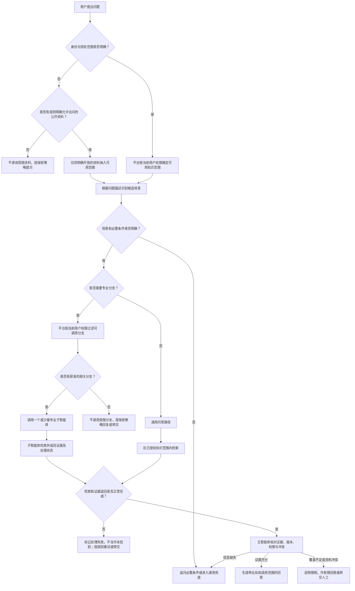

# 第九章 智能体架构设计与协同机制

## 引言：把系统拆成多个，不等于问题就会更简单

当知识库数量增加、业务领域变多，或者单个智能体回答不够稳定时，团队很容易想到：再建几个智能体，让每个智能体只负责一块。这个想法有时确实有效，但“多建几个”本身并不是解决方案。每多一个智能体，就多一套提示词、知识范围、权限关系、调用链路和维护责任；如果它们之间的分工没有明确价值，系统只是把原来的一段处理流程，变成了更多环节的接力。

设计时最重要的问题，不是“最多可以建多少个”，而是：这个任务是否真的需要不同的职责、权限或处理方法？新增的智能体能否带来可衡量的准确性、治理或业务收益？如果答案不清楚，先不要拆。

本章讨论如何区分知识库划分与智能体划分，什么情况下适合增加专业智能体，如何设计主智能体和子智能体的边界，以及怎样判断多智能体是否真的比单智能体更好。

## 一、知识库多，不等于智能体也要多

知识库是资料的组织和检索范围，智能体则是承担问答或任务职责的服务单元。两者有关联，但不是一一对应的关系。

一个智能体可以按用户问题检索多个知识库；一个业务领域也可能因为权限、维护责任或资料规模被分成多个知识库，却仍然由同一个智能体统一回答。反过来，即使资料在同一个知识库中，如果不同用户需要不同权限、不同工作流程或不同责任边界，也可能需要多个入口或服务角色。

| 变化 | 是否必然增加智能体 | 判断重点 |
| --- | --- | --- |
| 知识库数量增加 | 否 | 是否只是资料分类、容量或维护边界变化 |
| 目录层级变细 | 否 | 目录是否稳定，是否改变用户问题的处理方式 |
| 文档数量增加 | 否 | 检索质量、索引管理和授权能否在现有服务中处理 |
| 新增业务领域 | 不一定 | 该领域是否需要独立权限、规则、工具或责任主体 |
| 回答规则明显不同 | 可能需要 | 是否需要不同的答案格式、审核要求或风险控制 |
| 用户群体和访问权限不同 | 可能需要 | 能否在同一服务中可靠地执行授权隔离 |
| 任务可拆成独立并行工作 | 可能适合 | 子任务结果是否能够独立核验并合并 |

因此，不应把组织目录、知识库清单或平台可挂载数量直接转换成智能体数量。资料怎么分库，首先是知识治理问题；是否拆智能体，则要看业务职责和处理机制是否真的不同。

## 二、先看职责差异，再决定是否拆分

增加一个智能体，最好能明确回答“它为什么不能只是现有智能体中的一个检索范围或处理分支”。如果只能说“它对应一个部门”或“它有一批自己的文件”，理由通常还不够。

比较有说服力的拆分原因包括：

1. **授权边界不同。**不同用户群体可以访问的资料不同，而且权限无法在同一检索服务中被可靠地隔离和审计。即使拆成多个智能体，仍要确保调用端不会通过其他智能体绕过授权。
2. **回答责任不同。**某些答案需要由明确的业务责任方维护、审核或承担责任，不能与一般咨询混在一个无差别的回答口径里。
3. **处理规则不同。**同一个问题表面相似，但不同业务需要不同的判断条件、例外处理、风险提示或审批流程。
4. **工具与操作不同。**一个场景只需查询制度，另一个场景需要调用实时业务接口或发起有副作用的操作，且二者的授权与确认规则不同。
5. **发布和维护节奏不同。**某个专业场景需要独立测试、审批、版本管理和上线节奏，集中变更会明显影响其他场景。
6. **任务能够真正分解。**多个子任务可以并行处理，各自有清晰的输入、输出和验收方式，最后由一个协调者基于证据整合结果。

拆分理由越具体，越容易设计清楚智能体边界。比如“法律合规问答”如果采用更严格的资料范围、版本核验、风险提示和人工复核规则，就有可能成为独立场景；但如果只是把同一套制度查询按目录分成几个名字不同的智能体，未必能提升答案质量。

## 三、这些理由通常不足以单独支持拆分

以下情况经常被误认为必须建设多个智能体，但它们本身并不能证明拆分有收益：

- **“一个知识库太大了。”**先区分是检索质量、平台容量、权限还是维护问题。若只是容量和索引边界，可以先调整知识库组织，不一定要改变问答服务结构。
- **“目录有很多层。”**目录层级说明资料怎么分类，不一定说明用户需要经过不同的问答流程。
- **“想让每个智能体更专业。”**如果专业化只是多写几段提示词，而检索范围、规则、工具、证据和验收都相同，拆分可能只增加维护工作。
- **“有多个部门。”**部门边界与用户问法、资料边界不一定重合。某些问题天然跨部门，强行按部门分开会造成重复检索或遗漏。
- **“平台允许创建很多智能体。”**平台能创建，不代表业务上需要；数量上限是产品能力约束，不是架构设计目标。
- **“多查几个就会更准确。”**如果每次都让所有子智能体检索，可能增加调用、等待和结果整合负担，也可能引入不相关或相互冲突的证据。

当单智能体已经能够稳定路由到正确资料、执行权限过滤、给出可核验引用，并满足业务回答要求时，保持简单通常更有利于治理。

## 四、先区分四种常见架构

“多个智能体”不是一种固定形态。下表将智能体的组织方式与流程控制方式放在一起比较：前三类说明智能体如何分工，工作流说明由什么机制控制步骤；二者可以组合使用，并非互斥选项。

| 组织或控制方式 | 怎么工作 | 适合什么情况 | 主要风险 |
| --- | --- | --- | --- |
| 单智能体，多知识范围 | 一个智能体按问题在多个知识范围内检索和回答 | 规则相近、权限可控、回答由同一责任方维护 | 范围过宽时，检索容易混入不相关资料 |
| 主智能体路由专业子智能体 | 主智能体识别问题领域，只调用相关专业智能体 | 多个领域有清晰边界，但用户希望统一入口 | 路由错误、权限传递不当、子智能体输出格式不一 |
| 多个智能体并行分析 | 几个智能体分别完成独立子任务，再汇总 | 任务可并行拆分，结果能独立核验 | 调用变多，汇总复杂，错误可能互相传递 |
| 工作流编排（可与以上方式组合） | 由预先定义的步骤和条件控制处理顺序，也可负责路由或并行调度 | 流程稳定、步骤明确、必须留痕或经过人工确认 | 流程调整需维护；不应把不确定判断硬编码成固定分支 |

多智能体并不自动意味着自主协作。主智能体按规则挑选一个子智能体，属于路由；多个子智能体同时处理不同方面，属于并行分工；多个智能体相互讨论、互相批评或投票，则是另一种协作机制。它们的成本、错误模式和验收方法都不同，不宜统一称作“多智能体就会互相校验”。

## 五、路由要按业务描述，不要只按库名猜

主智能体要决定把问题交给谁，路由依据最好是“各场景负责回答什么、不回答什么”，而不只是知识库名称。库名通常是组织内部的管理名称，用户提问时未必会说出这个名称；相近的目录名也可能对应完全不同的业务含义。

每个候选智能体可以维护一张简短的场景说明卡：

| 项目 | 需要说明的内容 |
| --- | --- |
| 负责范围 | 该智能体回答哪些问题，使用哪些资料 |
| 不负责范围 | 哪些问题应交给其他场景或人工处理 |
| 典型问法 | 用户可能如何表达相关问题，包括常见简称和口语说法 |
| 必要条件 | 需要用户提供的对象、时间、机构或业务类型 |
| 可用工具 | 能执行哪些检索或业务查询，哪些操作不允许 |
| 输出要求 | 是否需要结论、依据、适用范围、风险提示或来源引用 |
| 升级条件 | 哪些问题需要补问、转交人工或同时查询其他领域 |

比如，“保险法律法规”不只是一个知识库名称。场景说明还应明确：它面向哪些主体和事项、是否包括监管通知与解释、是否处理地方规定、是否只提供资料解读而不出具个案法律意见。描述清楚后，主智能体才更有条件将用户的自然语言问题映射到合适的场景。

路由可以由工作流规则、大模型分类或二者结合完成。问题明确、边界稳定时，可以先用规则识别；问法多样、需要结合语义时，可以让大模型判断；不确定或跨领域时，可以采取少量候选并行检索、追问用户或走通用兜底。具体采用哪种方式，应通过真实问题测试，不宜预设一个适用于所有系统的固定分数阈值。

**权限与路由不是二选一。**主智能体可以根据不含受限内容的问题描述识别候选场景，但在检索知识或调用工具前，必须由平台或受控服务按照当前用户身份落实权限校验。模型可以判断“问题可能属于哪个场景”，但不能自行判定用户是否有权访问，也不能靠提示词把权限授给子智能体。若某个候选分支无法沿用当前用户的授权边界，就不应调用它检索受限资料。

## 六、拆分后，子智能体应返回证据，不只是结论

多智能体系统常见的问题是：子智能体检索到资料后，只把一段简短摘要交给主智能体。主智能体虽然能读到摘要，却不知道它依据哪份资料、哪个版本、哪一段原文，也无法可靠地把引用对应到最终答案中的每项结论。

因此，子智能体最好按照统一的数据约定返回结果，而不是自由发挥：

| 返回项 | 用途 |
| --- | --- |
| 处理状态 | 区分已找到证据、未找到、权限受限、检索失败、需要补充信息等情况 |
| 子任务结论 | 用简短语言说明当前证据支持什么，不支持什么 |
| 资料名称与稳定标识 | 让主智能体和用户能够定位原始资料 |
| 版本、状态与时间范围 | 避免把历史、待生效或不适用资料当成当前依据 |
| 原文片段及位置 | 支持逐项核对结论和生成引用 |
| 适用对象与条件 | 保留限定条件、例外和前提 |
| 未确认点与冲突 | 防止汇总时把不确定内容改写成确定事实 |
| 系统校验后的权限结果或本次允许传递的证据范围 | 确保主智能体只使用当前用户有权查看的资料；不把原始权限配置交给模型自行判断 |

主智能体负责检查子任务是否覆盖用户问题、证据是否互相冲突、结论有没有超出原文，然后再组织最终答案。主智能体不应把多个子智能体的结论简单拼接，也不能补造缺失的文件名、条款号或引用。

这套数据约定可以理解为团队协作时的交接单：每个专业人员不仅要交结论，还要交依据、适用条件和未解决事项。若所用平台无法直接传递原始引用对象，至少应确认能否传递来源标识、原文片段和定位信息，并通过实际调用记录验证，而不能仅凭“子智能体有引用”就假定主智能体也能展示。

## 七、多智能体的成本不止是多调用几个模型

每增加一个子智能体，可能增加模型调用、检索请求、上下文传递、权限配置、提示词维护、版本发布和故障排查。若主智能体每次都调用全部子智能体，成本和等待时间会随着分支数量上升；若多个子智能体使用重叠的知识范围，还可能返回大量重复片段，增加主智能体筛选负担。

一项2026年发表于《自然·机器智能》的受控实验研究，在六类基准任务、五种架构和260种配置下比较了单智能体与多种协作结构。研究报告显示，多智能体在可分解的金融推理任务中相对单智能体基线最高提升80.8%，而在序列规划任务中最高下降70%；研究还发现，单智能体基线表现是判断协同能否带来收益的重要指标。[1] 这些结果受论文采用的模型、任务、协作方式和实验设置影响，且研究对象不是企业知识问答，不能直接当作多智能体方案的通用收益，也不能据此推算本项目的准确率或响应时间。它们说明的是：架构收益取决于任务特征，不能简单认为智能体越多越好。

在企业知识问答中，应重点观察以下开销：

- **路由开销：**主智能体是否把问题送到正确领域，是否反复尝试多个分支。
- **检索开销：**每个分支检索多少资料、是否重复查询同一知识范围。
- **传递开销：**子智能体是否把大量全文或长摘要交给主智能体，导致上下文膨胀。
- **等待开销：**调用是否串行，慢分支是否拖住整条回答链路。
- **治理开销：**每个智能体的提示词、权限、知识范围和答案格式是否需要独立维护。
- **故障开销：**一个分支失败时，系统是否能识别并给出有限回答，而不是把局部失败当成全局成功。

因此，性能评估不应只看单次模型生成速度。要记录端到端耗时、调用次数、检索次数、输入输出长度、错误和重试情况，并检查哪些分支实际对答案有贡献。

## 八、主要风险是边界不清和错误被放大

多智能体把工作拆开后，新的风险也随之出现：

1. **路由漏掉正确领域。**用户使用简称、跨领域表达或缺少背景时，分类器可能没有选中应该查询的智能体。
2. **路由过宽。**每个问题都交给所有子智能体，导致无关资料涌入，答案看似全面却更难判断依据。
3. **答案口径不一致。**不同子智能体对“当前有效”“适用对象”“是否可以推断”等规则理解不同。
4. **来源在传递中丢失。**子智能体的总结被主智能体引用为事实，但最终答案没有保留原始出处。
5. **权限边界被绕过。**主智能体或某个子智能体使用了比当前用户更广的账号权限，导致不应展示的内容进入答案。
6. **互相引用形成错误共识。**后续智能体把前一个智能体的推断当成可靠前提，反复转述后看起来像被多方确认。
7. **版本和规则漂移。**多个智能体的提示词、知识范围和更新节奏不同，维护人员难以确认实际生效的答案规则。
8. **失败被掩盖。**某个子智能体超时或检索失败，主智能体没有检查状态，却继续用其他分支的结果回答完整问题。

“几个智能体给出相同答案”并不自动构成多份独立证据。如果它们访问的是同一份文件，或者都依赖同一段未经核验的摘要，这只是重复了同一个来源。真正的交叉核验要看来源是否独立、材料是否适用、结论是否有原文支撑。

## 九、用一个中心协调者，保留必要的控制

对企业问答而言，常见的稳妥起点不是让多个智能体自由互聊，而是让主智能体承担明确的协调职责：识别问题、提出候选场景，由平台或受控服务按照当前用户权限确认可调用范围，再收集结构化证据、检查覆盖与冲突，最后统一生成答案。子智能体专注于自己的资料范围和检索任务，不独自决定超出职责边界的业务结论。

图中的“一个或少量”是设计原则，不是固定数量上限。简单且边界清晰的问题优先走单一分支；确实涉及多个独立领域时，才并行调用相关分支；如果需要人工确认，就保留人工处理出口。权限由平台或受控服务校验，路由只识别候选场景，不授予访问权限。路由不明确时应追问或进入兜底；任何分支失败都要保留失败状态，不能被其他分支的成功掩盖。系统应能说明本次实际检索了哪些场景，尤其在用户提出“全部”“完整清单”等问题时。

## 十、用数据决定拆不拆、留不留

是否增加智能体，不能只在方案评审会上凭感觉决定。建议先收集真实问题，建立单智能体基线，再对候选拆分方案做同一批问题的对照测试。

| 评估维度 | 可以观察什么 | 判断目的 |
| --- | --- | --- |
| 路由质量 | 正确场景命中率、漏路由、误路由、跨领域识别 | 拆分后是否能把问题送到正确位置 |
| 答案质量 | 关键事实准确性、条件完整性、无依据内容 | 专业化是否改善了实际回答 |
| 证据质量 | 引用覆盖、出处准确、原文支持、版本适用 | 子智能体结果是否能被核验和追溯 |
| 权限安全 | 越权检索、标题或摘要泄露、跨智能体传递 | 拆分是否引入新的授权风险 |
| 检索覆盖 | 相关知识是否遗漏，是否重复召回 | 路由是否缩小范围但没有漏掉重要资料 |
| 效率成本 | 端到端耗时、调用数、检索数、资源使用 | 质量收益是否值得额外开销 |
| 维护成本 | 提示词和权限规则变更数、发布和回归工作量 | 是否出现难以持续治理的分支数量 |

测试集应包含常见问题、边界问题、跨领域问题、含糊问法、无答案问题、资料冲突问题和权限受限问题。路由测试要检查“该调用的分支是否被调用”以及“不该调用的资料是否被排除”；最终回答测试还要检查证据和引用，不能只用关键词命中作为通过标准。

当某个子智能体长期没有独立贡献，或者它的效果与原有路径相同但增加了明显维护成本，可以考虑合并或下线。拆分是架构选择，不是不可逆的组织承诺；系统应定期复盘哪些分支实际被调用、解决了什么问题、带来多少额外成本。

## 十一、从一个智能体开始，逐步增加必要的专业能力

对多数企业问答项目，一个可控的建设顺序是：

1. **先定义场景和边界。**确定用户是谁、问题范围是什么、资料来源有哪些、什么情况必须拒答或转人工。
2. **建立单智能体基线。**用代表性问题验证检索范围、答案准确性、权限过滤和引用展示，避免把基础治理问题误判为“需要更多智能体”。
3. **找出重复出现的结构性差异。**从真实日志中识别哪些问题在资料授权、处理规则、工具、责任方或审查要求上确实不同。
4. **只拆一个有清晰收益的候选场景。**为它写明负责范围、不负责范围、输入输出和权限规则，优先用少量真实问题试运行。
5. **比较拆分前后的表现。**检查答案、证据、权限、端到端耗时和维护成本，而不是只看演示效果。
6. **稳定后再考虑统一入口和更多分支。**如果用户不应自行选择场景，可由主智能体路由；若路由风险高或业务责任要求明确，也可以让用户显式选择场景。

这不是必须按阶段实施的固定项目计划，而是一种降低架构决策风险的办法：先把单一场景做好，再根据实际问题证明是否需要拆分。

## 结语：架构复杂度要由业务收益来支付

多智能体适合解决职责不同、权限不同、规则不同或可并行分解的问题；它不适合被当作知识库数量增长后的默认扩容方式。多个知识库可以由一个智能体按业务范围选择检索；多个部门也可以共用一套服务，只要职责、授权和答案口径能够清楚治理。

当确实需要拆分时，主智能体要承担路由与整合责任，子智能体要返回可核验的原始证据和状态；权限要在检索前检查，出处要在传递中保留，失败和冲突要显式报告。是否保留一个分支，最终要由问答质量、证据可靠性、安全性、响应成本和维护成本共同决定。

> 多智能体的目标不是让系统看起来更复杂，而是让复杂业务获得更清晰的分工、更可靠的证据和可控的责任边界。

## 延伸阅读

1. Yubin Kim 等：《Capable language models can outgrow the benefits of collaboration》，《自然·机器智能》第8卷，1157–1172页，2026年，DOI：10.1038/s42256-026-01268-y。该研究比较了单智能体和多种协作结构在不同基准任务上的表现。论文结果来自特定实验设置，不应直接当作企业问答系统的性能承诺。[1]
