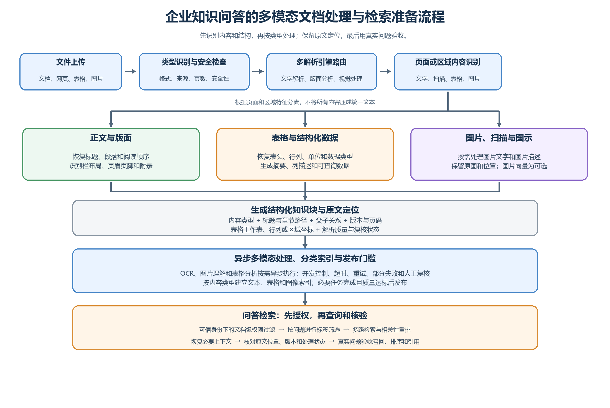
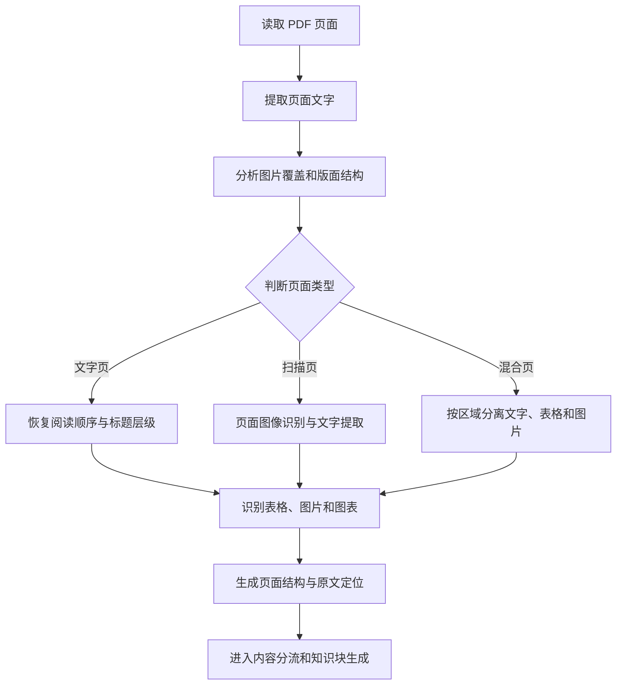
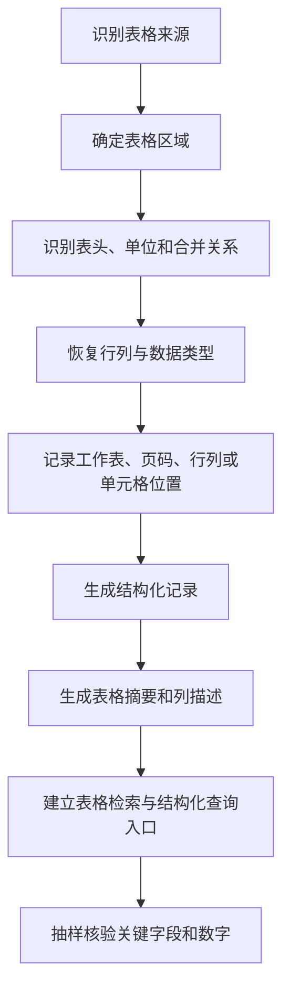

# 第五章 多模态文档解析与知识单元构建

## 引言：检索效果不是从搜索按钮开始的

用户向系统提问时，通常只看到最后的回答，很少看到资料在进入知识库之前经历了什么。实际上，问答能不能找到正确依据，往往在文档处理阶段就已经决定了大半。

过去常见的处理路径是：

```text
文件上传 → OCR → 提取文字 → 固定长度切片 → 统一向量化
```

这条路径适合结构简单、以连续正文为主的资料，但企业资料往往同时包含正文、表格、图片、流程图、扫描页、附件和复杂版面。如果把这些内容都压成一段文字，系统即使“读到了文字”，也可能已经丢失了标题层级、表头关系、页面位置和图文关联。

更适合企业知识库的处理思路是：

```text
多解析引擎路由
    → 页面或区域内容识别
    → 版面结构恢复
    → 正文、表格、图片分别处理
    → 生成带原文定位的结构化知识块
    → 按内容类型建立索引
    → 用真实问题验收召回、排序和引用效果
```



**图5-1 多模态文档处理与问答检索准备总流程**
本章讨论的重点，不是把某个文件转换成多少字，而是如何把复杂资料转化为**可检索、可引用、可定位、可验证的知识单元**。需要回答的核心问题有四个：

1. 不同文件和不同页面，应该选择什么处理方式？
2. 正文、表格、图片和图片型页面，应该如何分别处理？
3. 如何保留原文结构、父子关系和出处位置？
4. 什么样的解析结果，才真正适合进入知识问答？

## 一、文档处理不是文字搬运

一份文件进入知识问答系统后，至少要满足以下要求：

1. **内容读得对。**正文、标题、表格、图片、脚注和附件没有明显漏读、错读或重复读取。
2. **结构保得住。**系统能够区分标题、段落、条款、条件、例外、表头、图片和说明文字。
3. **关系连得上。**表头与数据、图片与正文、条款与章节、子片段与父级上下文之间仍然存在关联。
4. **位置找得到。**命中的内容能够回到原始文件、页码、章节、工作表、行列或页面区域。
5. **类型分得开。**正文、表格、图片文字、图片描述和结构化数据不被强行当成同一种普通文本。
6. **质量验得过。**解析完成、索引完成和可以可靠回答问题，是三个不同的判断，不能混为一谈。

### 1. 统一文字处理为什么容易出问题

如果只保留一段连续文字，后续环节可能遇到以下问题：

- 标题和正文的层级关系被打乱，片段失去主题范围；
- 多栏页面的阅读顺序错乱，上一栏和下一栏被拼接到一起；
- 表格中的字段、行、列和数值失去对应关系；
- 图片中的关键文字、数字和流程关系没有被识别；
- 页眉、页脚、目录和正文混在一起，造成重复召回；
- 条件、例外和否定词被切到不同片段，回答只看到一般规则；
- 解析结果无法定位到页码或原始区域，答案即使看起来合理也无法核验。

因此，文档处理的最终产物不应只是“提取出的文字”，而应是一组带有结构、类型、关系、定位和质量信息的知识块。

### 2. 文档处理的目标是形成可用的知识单元

一个适合进入问答的知识单元，至少应包含以下信息：

| 信息 | 说明 |
| --- | --- |
| 内容本身 | 正文、表格记录、图片文字或图片描述等实际内容 |
| 内容类型 | 正文块、表格块、图片文字块、图片描述块或结构化数据 |
| 上下文 | 知识标题、章节路径、表格标题或父级说明 |
| 原文定位 | 文件、版本、页码、工作表、行列、区域坐标等 |
| 关联关系 | 父块、子块、相邻块、所属表格或关联图片 |
| 处理质量 | 解析方式、置信度、是否需要人工复核、是否允许发布 |

这些信息不一定全部展示给最终用户，但应尽可能保留在系统内部。只有这样，后续检索、重排、引用和问题追溯才有稳定的基础。

## 二、先识别内容，再选择处理方式

“支持某种文件格式”只说明系统能够接收这个文件，并不代表同一种格式的所有文件都可以用同一条处理链路。解析前应先完成文件类型识别、内容特征判断和安全检查，再决定采用什么解析方式。

### 1. 文件类型与处理方式

| 文件或内容类型 | 常见特点 | 推荐处理方式 |
| --- | --- | --- |
| 普通文本、Markdown | 结构相对清楚，内容以连续文字为主 | 直接提取文本，保留标题层级和列表关系 |
| Word 文档 | 同时包含标题、段落、表格、图片和批注 | 识别文档结构，分别处理正文、表格和图片 |
| 文字型 PDF | 通常存在文字层，但可能有多栏、页眉页脚和复杂版面 | 提取文字，恢复阅读顺序，保留页码和区域 |
| 图片型 PDF | 页面本质上是扫描图像，没有可用文字层 | 按页转为图像，进行视觉识别和结构恢复 |
| 混合型 PDF | 文字页、扫描页、表格页和图片页混合存在 | 按页面或区域判断，分别选择文字解析或视觉处理 |
| Excel 文件 | 数据按工作表、行和列组织 | 识别工作表、表头、字段、数据类型和记录位置 |
| 图片文件 | 信息可能位于文字、表格、流程图或统计图中 | 先判断内容价值，再选择文字识别、图片描述或图片向量 |
| PPT 文件 | 内容分布在文本框、图表、图片和备注中 | 保留页面顺序，区分正式内容、图表和备注 |
| 网页或在线资料 | 内容和页面可能持续变化 | 保存来源、访问时间和版本信息，避免只保留复制文本 |
| 临时上传文件 | 通常服务于当前会话，来源和效力未必明确 | 记录会话范围和实际输入，不能自动当作正式知识 |

### 2. 先做安全检查和基本登记

文件进入解析流程前，应完成最基本的登记和检查：

- 文件来源、上传人、所属业务范围和处理用途；
- 文件格式、大小、页数或工作表数量；
- 是否包含密码、宏、外部链接或不允许处理的内容；
- 是否存在重复文件、相同内容的不同文件名或疑似旧版本；
- 是否包含敏感信息，后续处理是否符合访问和使用要求；
- 是否需要保留原文件，以便回答时回看原文。

安全检查不能替代权限控制。文件能否被解析，和谁有权检索、查看或下载该文件，是两个不同问题。

### 3. 解析路由的基本逻辑

解析路由可以理解为“先判断，再分流”：

```text
识别文件格式
    ↓
判断文字层、图片、表格和版面特征
    ↓
判断文件级还是页面/区域级处理
    ↓
选择主解析方式
    ↓
根据质量信号决定是否局部回退
    ↓
合并结构化结果并保留来源定位
```

这里的关键不是增加很多工具，而是让系统能够根据内容特征选择处理方式。例如，文字型 PDF 不需要整份文件都转成图片；混合型 PDF 也不应该因为其中几页是扫描件，就让所有页面都走成本更高的视觉处理。

## 三、多解析引擎如何协同工作

企业知识库通常需要多种解析能力协同完成工作。不同解析能力不是互相替代，而是分别解决不同问题。

### 1. 不同解析能力的职责

| 解析能力 | 主要解决的问题 | 适用内容 |
| --- | --- | --- |
| 基础文字解析 | 读取正文、标题、列表和普通段落 | 文本、Markdown、结构简单的办公文档 |
| 通用格式转换 | 将不同文件转为统一的中间表示 | 多种办公文件和常规文档 |
| 版面结构解析 | 识别标题、段落、栏、表格、图片和页面区域 | 复杂 Word、PDF 和图文混排文件 |
| 专业页面解析 | 恢复复杂 PDF 的阅读顺序和页面关系 | 多栏、脚注、附录、复杂排版文件 |
| 文字识别 | 从扫描页或图片中识别明确的文字 | 图片型 PDF、图片文字、扫描材料 |
| 视觉内容理解 | 判断图表、流程图、表单和图片表达的含义 | 流程图、统计图、复杂图片和图文混排页面 |
| 表格结构解析 | 恢复表头、行列、合并单元格和数据类型 | Excel、PDF 表格、图片表格 |

同一份资料可以同时使用多种能力。例如，先用页面分析判断某页有文字、表格和图片，再分别处理文字区域、表格区域和图片区域。这样比让一个解析器把整页压成连续文字更容易保持原意。

### 2. 统一的中间结果比统一的解析器更重要

不同解析引擎最终应尽量输出相对统一的中间结果，使后续的切片、定位和索引不依赖某一个解析器的内部格式。至少可以统一以下字段：

```text
文档标识
版本标识
内容类型
正文或结构化内容
知识标题
章节路径
页码或工作表
区域、行列或单元格位置
父级标识
关联内容标识
解析方式
处理质量和复核状态
```

统一中间结果并不要求所有资料都变成同一种纯文本。它的含义是：不同内容都能用明确的类型、来源和关系表示，后续环节知道该如何处理它。

### 3. 解析失败时要能够局部回退

解析路由应当有主路径，也应当有回退路径：

- 文字层存在但阅读顺序明显错误时，回退到版面分析或页面视觉处理；
- 页面文字提取为空，但图片覆盖率很高时，进入文字识别流程；
- 表格结构识别失败时，保留原图、页面位置和可读文字，进入人工复核；
- 图片描述失败时，仍保留图片文字或原始图片，不应把空描述当作事实；
- 某一页处理失败时，允许其他页面先完成，但文档发布前要记录缺失页和处理状态。

回退不是让所有文件都走最重的处理方式，而是在出现质量信号异常时，只对有问题的页面或区域增加处理。

### 4. 结构化 Markdown 只是中间表达，不是最终证据

结构化 Markdown 适合把标题、段落、表格和图片关系表达出来，便于后续切片和人工检查。例如：

```markdown
# 差旅管理办法

## 第二章 费用标准

### 第十二条 住宿费

[正文] 不同人员级别在不同地区的住宿标准见下表。

[表格]
标题：住宿标准
表头：人员级别｜地区｜住宿上限
来源：第 6 页，表格区域

[图片]
类型：审批流程图
来源：第 8 页，右侧区域
```

但结构化 Markdown 仍然是处理结果的表达形式，不能替代原始文件、原始图片或结构化数据。表格的行列关系、图片的区域坐标和原文链接仍应单独保存。

## 四、PDF 应该按页面或区域处理

PDF 不是一种统一内容，而是一组可能采用不同编码方式和版面结构的页面。一个文件的前几页可以是电子正文，中间几页可能是扫描件，后面还可能包含图片表格和流程图。因此，不宜只在文件级别把 PDF 粗略分成“文字型”或“图片型”，而应尽量按页面或区域判断。

### 1. 页面级处理流程



### 2. 三类页面的处理重点

| 页面类型 | 识别特征 | 处理重点 |
| --- | --- | --- |
| 文字页 | 有可用文字层，文字覆盖和顺序基本正常 | 恢复阅读顺序，识别标题、段落、表格和图片，清理重复页眉页脚 |
| 扫描页 | 文字层为空或质量过低，页面主要由图像组成 | 转为图像，进行文字识别和版面恢复，核对数字、日期和否定词 |
| 混合页 | 同一页同时有文字、扫描区域、表格或图片 | 按区域分流，避免重复识别和文字覆盖，分别保存区域位置 |

对于文字页，需要特别检查多栏排版、隐藏文字、目录和正文的重复内容、脚注与正文的关系。对于扫描页，文字识别只是开始，还要恢复标题、段落、列表和表格结构。对于混合页，不能把图片区域的文字和页面文字重复拼接。

### 3. PDF 处理的三个边界

第一，**不是所有 PDF 都需要转成图片**。有质量较好的文字层时，应优先使用文字解析，仅对扫描页或问题区域转图处理。

第二，**不是所有页面都需要同样的识别强度**。纯正文页面可以走轻量解析，复杂表格、流程图和低质量扫描页再使用更强的视觉处理。

第三，**页面位置必须跟随内容**。正文块、表格块、图片文字块和图片描述块都应关联页码和区域，不能只在文档级别保存一个来源名称。

### 4. 页面解析的检查结果

页面级处理完成后，至少应能回答：

- 这一页是否有可用文字层？
- 页面中是否存在表格、图片、流程图或印章？
- 正文阅读顺序是否正确？
- 识别结果对应原始页码和哪个区域？
- 这一页是否存在低置信度或未处理区域？
- 页面处理失败是否影响整份文档发布？

这些结果既用于后续生成知识块，也用于问题排查。否则出现漏召回时，很难判断是页面没有解析、内容没有切片，还是检索没有命中。

## 五、表格如何变成可检索的结构化知识

表格的难点不是“单元格里的文字有没有出来”，而是字段、行、列、单位、时间口径和数值关系有没有保留。表格一旦失去这些关系，数字即使被识别出来，也可能无法用于可靠回答。

### 1. 不同来源的表格需要不同处理

| 表格来源 | 常见问题 | 处理重点 |
| --- | --- | --- |
| Excel 表格 | 多工作表、合并单元格、空行、公式、隐藏列 | 识别工作表、表头、字段、数据类型、行号和原始单元格 |
| PDF 表格 | 跨页、表头重复、边框不完整、列错位 | 恢复表格区域、表头、单位、跨页关系和页码 |
| 图片表格 | 文字识别错误、网格线干扰、单元格边界不清 | 先识别表格区域，再识别行列和文字，抽样核对关键数字 |

同一张表可以同时保留原图、结构化数据、文字表达和来源定位。它们服务于不同用途，不应为了方便而只保留其中一种。

### 2. 表格处理的基本流程



### 3. Excel 不应被拼成一篇长文章

Excel 文件建议按以下顺序处理：

1. 读取工作簿和工作表名称。
2. 过滤真正为空的工作表，识别隐藏或辅助工作表。
3. 判断表头所在行，处理多行表头和合并单元格。
4. 识别字段类型、单位、日期口径、空值和公式结果。
5. 按数据行或业务对象组织记录，保留行号和原始单元格位置。
6. 生成表格摘要、列描述和可查询的数据结构。
7. 对关键记录和异常值进行抽样核验。

例如，下面的表格：

| 人员级别 | 出差地区 | 住宿上限 |
| --- | --- | ---: |
| 普通员工 | 北京 | 500 |
| 部门负责人 | 北京 | 700 |

不应只转换成“普通员工 北京 500 部门负责人 北京 700”。更适合的结构化表达是：

```text
人员级别：普通员工；出差地区：北京；住宿上限：500 元
人员级别：部门负责人；出差地区：北京；住宿上限：700 元
```

同时保留工作表名称、表头、行号、单位和原始单元格位置。这样用户问“部门负责人在北京的住宿上限是多少”时，系统既能检索到语义表达，也能回到原始记录核验。

### 4. 表格摘要、列描述和结构化查询要分工

表格通常需要形成三类结果：

| 结果类型 | 解决的问题 | 适用场景 |
| --- | --- | --- |
| 表格摘要 | 这张表记录什么内容，覆盖什么对象和时间 | 找表、理解业务范围 |
| 列描述 | 每一列代表什么，单位和口径是什么 | 找字段、理解指标含义 |
| 结构化数据 | 每条记录的字段和值是什么 | 条件筛选、统计、排序、汇总 |

普通文本检索适合回答：

- 这张表主要记录什么？
- 表里有哪些字段？
- 哪一列表示住宿上限？
- 某项指标出现在哪些年份？

但以下问题不应只依赖普通文本检索：

- 一共有多少条记录？
- 哪个部门数量最多？
- 金额总和是多少？
- 按金额从高到低排序；
- 找出满足多个条件的全部记录；
- 计算平均值、同比或占比。

这类问题应由结构化查询和确定性计算完成。普通文本检索负责找到相关表格和字段，结构化查询负责读取数据，计算工具负责完成统计、筛选、排序和汇总。表格摘要不能代替完整数据，检索命中也不代表计算已经完成。

### 5. 表格切片不能丢掉表头

表格切片时，应根据数据规模和问题类型选择方式：

- 小表可以保留完整表头和全部记录；
- 大表可以按业务对象、时间范围或记录区间切分，但每个片段都要带上表头、单位和口径；
- 跨页表要识别重复表头和续表关系，不能把续表当成一张没有标题的新表；
- 合并单元格的含义要扩展到其覆盖的记录，不能只保留视觉上的一个格子；
- 对需要统计的问题，应保留完整结构化数据或可查询入口，不要只生成摘要片段。

## 六、图片和图片型 PDF 如何进入问答系统

图片不是只有“做不做文字识别”这一种选择。图片可能是扫描文字、表格、流程图、组织架构图、统计图、表单、印章或纯装饰图，不同内容的处理目标不同。

### 1. 先判断图片是否有问答价值

| 图片类型 | 是否通常需要处理 | 主要处理方式 |
| --- | --- | --- |
| 纯装饰图片 | 通常不需要 | 记录位置即可，避免生成无意义内容 |
| 扫描文字页 | 通常需要 | 页面文字识别、版面恢复和关键内容核验 |
| 图片表格 | 通常需要 | 表格区域识别、行列恢复和数字核验 |
| 流程图、组织架构图 | 视问题需要 | 文字识别加关系描述，保留原图和区域 |
| 统计图、趋势图 | 视问题需要 | 识别图例、坐标、趋势和文字说明，谨慎生成结论 |
| 表单或票据 | 视业务需要 | 识别字段、填写值和位置，敏感字段按权限处理 |
| 印章或签批区域 | 视业务需要 | 记录图像存在和位置，不能仅凭图像描述认定法律效力 |

图片先做内容判断，再决定是否进行文字识别、图片描述或图片向量处理。不能把所有图片都送入同一种处理流程。

### 2. 图片型 PDF 的处理流程

```text
扫描 PDF 页面
    ↓
页面转换为图像
    ↓
识别标题、段落、表格和图片区域
    ↓
分别执行文字识别、表格识别和图片理解
    ↓
恢复页面阅读顺序与结构关系
    ↓
生成图片文字块、表格块和图片描述块
    ↓
关联原始页码、区域和父级正文
    ↓
进入相应索引并接受质量检查
```

图片型 PDF 的处理重点是恢复页面结构，而不是只得到一份 OCR 文本。识别结果应尽可能保留标题、段落、列表、表格、图片和区域坐标。低置信度文字、关键数字、日期、否定词和条款编号应进入抽样核验或人工复核。

### 3. 图片处理失败要能够降级

图片理解失败时，可以根据业务重要性选择降级方式：

- 保留原图和页码，允许人工查看；
- 如果图片中有可读文字，保留文字识别结果，但标记识别质量；
- 如果只生成了图片描述，不能把描述直接当作原文事实；
- 如果图片属于非关键装饰内容，可以跳过图片索引，不阻断正文发布；
- 如果图片包含关键规则、金额或审批关系，应暂停该部分发布或进入人工复核。

图片不能成为系统“看起来已经处理、实际上没有可靠依据”的隐性缺口。

## 七、图片文字、图片描述和图片向量的分工

图片处理后可能得到三类不同结果：图片文字、图片描述和图片向量。它们的用途不同，证据强度也不同。

| 结果 | 主要作用 | 能否直接作为权威原文 | 常见使用方式 |
| --- | --- | --- | --- |
| 图片文字 | 找到图片中明确写出的标题、字段、数字和条款 | 经过核验后可以作为原文转录 | 关键词检索、引用图片文字 |
| 图片描述 | 说明图片表达的场景、关系和整体含义 | 不能替代原图和原文 | 辅助召回、帮助模型理解图示 |
| 图片向量 | 根据图片整体视觉特征做相似匹配 | 不能单独作为事实依据 | 图片相似检索、图像内容召回 |

例如，一张“理赔流程图”可能同时产生：

- 图片文字：识别“报案、审核、赔付”等流程框文字；
- 图片描述：说明流程大致从报案开始，经过审核后进入赔付；
- 图片向量：帮助召回结构相似的流程图。

当用户询问“流程中哪一步需要补充材料”时，系统应尽量回到原图、图片文字和相关正文共同核验，而不能只依据自动生成的图片描述。

### 1. 不要默认所有内容都建立图片向量

图片向量有助于按照视觉内容做相似检索，但它并不适合替代文字检索、表格查询和原文引用。是否生成图片向量，要结合以下条件判断：

- 业务问题是否真的会按图片整体内容检索；
- 图片是否具有稳定的视觉语义，而不是普通扫描页；
- 当前平台、模型和索引链路是否支持图片向量；
- 生成和维护成本是否值得；
- 检索命中后是否能够返回原图和可核验位置。

如果图片主要是扫描文字，优先保证文字识别和页面定位；如果图片主要是复杂流程或图表，再考虑图片描述和图片向量。

### 2. 图片描述必须标注来源性质

图片描述是模型对图片的解释，不是资料原文。系统内部应区分：

- 原始图片中的文字；
- 由识别得到的文字转录；
- 由模型生成的图片描述；
- 人工确认后的业务解释。

回答涉及金额、日期、审批关系、法律效力或责任结论时，应优先引用原始图片、识别文字或正文依据，并说明图片描述仅用于辅助理解。

## 八、原文定位、父子知识块和上下文恢复

检索单元不一定等于最终回答单元。系统可能先命中一段图片文字、一个表格列描述或一个很短的正文片段，然后需要通过父子关系恢复必要的上下文和原文出处。

### 1. 常见知识块类型

| 知识块类型 | 作用 | 典型来源 |
| --- | --- | --- |
| 父级知识块 | 保存标题、章节背景和主要说明 | 文档、章节、页面或表格所属段落 |
| 正文块 | 保存条款、段落或操作步骤 | 文字层、结构化 Markdown |
| 表格摘要块 | 说明表格用途、范围和字段 | Excel、PDF 表格或图片表格 |
| 表格列描述块 | 解释某一字段的含义、单位和口径 | 表头和业务说明 |
| 表格记录块 | 保存具体行或业务对象的字段和值 | Excel 或恢复后的表格数据 |
| 图片文字块 | 保存图片中明确识别出的文字 | 图片、扫描页、流程图 |
| 图片描述块 | 保存图片表达的语义和关系 | 流程图、统计图、复杂图片 |
| 原图关联块 | 保存原始图片、区域和访问位置 | 图片或 PDF 页面区域 |

这些知识块不必全部使用同一种检索方式，也不必全部生成同一种向量。关键是它们之间要保留可追踪的关系。

### 2. 片段切分应服从内容结构

切片不是越小越好，也不是越大越完整。切片的目标是形成一个足够独立、又不丢失必要条件的知识单元。

- 制度、办法和法规优先按章、节、条、款以及完整规则段落切分；
- 操作手册优先按一个任务步骤或完整办理环节切分；
- 常见问答按一个问题及其完整答案切分；
- 案例按背景、问题、处理、结果和适用边界组织；
- 表格按完整表头加记录区间切分；
- 图片按页面或区域切分，并保留与父级正文的关系。

对于条件、例外和否定规则，应尽量在同一知识单元内保留完整表达：

```text
一般情况下，……。
但有下列情形之一的，不适用前款规定：……。
```

如果这两句话被拆成互不关联的片段，系统可能把一般规则误说成无条件规则。因此，必要时应使用章节路径、条款编号、关联片段或父级知识块补回上下文，而不是单纯增加固定字数的重叠。

### 3. 原文定位信息应贯穿处理链

每个知识块至少应尽量保存以下定位信息：

| 定位信息 | 说明 |
| --- | --- |
| 文档标识 | 指向原始文件或稳定文档记录 |
| 版本标识 | 区分不同版本，支持版本核验 |
| 知识标题 | 用于展示和引用，不用文件名冒充正式标题 |
| 章节路径 | 记录章、节、条或业务层级 |
| 页码或页面范围 | 支持 PDF、扫描件和页面引用 |
| 区域坐标 | 定位到页面中的表格、图片或文字区域 |
| 工作表与行列 | 定位到 Excel 的工作表、行号、列名或单元格 |
| 父子关系 | 从局部片段回到章节、表格或原图 |

定位信息不是装饰字段。它既服务于最终引用，也服务于内部排查：当答案错误时，可以判断错误来自原文、解析、切片、索引还是答案生成。

### 4. 标签、权限与正文的关系

全库可以统一使用三项基础标签：

| 基础标签 | 主要作用 | 使用边界 |
| --- | --- | --- |
| 知识标题 | 识别和展示资料 | 不能用文件名或模型猜测的主题冒充正式标题 |
| 生效时间 | 处理明确的时间条件 | 没有原文依据时留空，不能用发布日期随意替代 |
| 状态 | 区分当前适用和不再适用的版本 | 只使用“生效”和“失效”，由责任人根据正式依据确认 |

业务目录、业务主题、资料类型、适用对象等字段，应根据具体业务域按需增加，不要求所有知识库配置完全相同。版本关系、来源主体、责任部门、核验记录和解析任务状态可以作为后台治理信息保存，不必全部变成面向用户的筛选标签。

权限不是普通标签。每次检索前，都应依据可信身份执行文档级授权过滤，再进行标签筛选、内容检索和重排。不能让模型根据用户自称的部门自行判断权限，也不能先把无权资料召回后再靠答案生成阶段删除。

### 5. 检索前到答案生成的关系


标签负责缩小范围，正文和结构化数据负责提供依据，图片描述只能辅助理解，权限机制负责决定哪些文档可以进入检索。它们不能互相替代。

## 九、异步处理、失败回退和质量控制

图片理解、表格分析、文字识别和图片向量生成通常比普通文字解析耗时更长。生产环境不宜把所有工作都放在用户等待的同步请求中，而应将文档处理拆成可追踪、可重试、可恢复的任务。

### 1. 建议的任务处理链

```text
文件上传
    ↓
基础登记和安全检查
    ↓
完成基础解析并保存原始定位
    ↓
创建图片、表格和视觉处理任务
    ↓
按并发限制执行文字识别、图片理解和结构化处理
    ↓
更新知识块、父子关系和索引状态
    ↓
执行质量检查和人工复核
    ↓
满足发布门槛后进入问答范围
```

### 2. 需要区分三类状态

**第一类是业务生效状态。**这是面向知识使用的基础状态标签，本书统一只使用“生效”和“失效”。

**第二类是技术处理状态。**它说明解析和索引任务走到了哪一步，例如待处理、处理中、处理完成、部分完成、处理失败和需人工复核。这些状态不能当作资料生效状态。

**第三类是治理流程状态。**它说明资料是否完成业务审核、发布和责任确认，例如草稿、待核实、待审核、待发布等。这些状态属于后台流程，不应扩展成全库通用业务标签。

把三类状态混在一起，会出现“文件解析成功就被当成生效资料”“文档生效但图片还没有完成识别”等错误。

### 3. 生产环境至少要有以下控制

- **任务队列：**把图片识别、表格解析和向量生成从上传请求中拆开；
- **并发控制：**限制同时处理的页数、图片数和大型表格数量，避免资源被单个文件占满；
- **超时和重试：**区分可重试错误与需要人工处理的错误，避免无休止重试；
- **幂等和任务追踪：**同一文件或同一页重复执行时，不重复生成不可区分的知识块；
- **部分失败：**单页或单图失败时保留已完成结果，并明确缺失范围；
- **质量门槛：**关键表格、流程图、金额和条款识别不合格时，不能直接发布；
- **人工复核：**低置信度内容、结构错乱页面和关键业务资料进入人工确认；
- **版本一致性：**文档、解析结果、知识块、向量和索引应能关联到同一版本；
- **可观测记录：**保留解析方式、配置版本、失败原因、重试结果和复核意见。

### 4. 临时上传文件也要有边界

用户在对话中临时上传的文件，与企业长期维护的正式知识库资料不是同一种东西。临时文件应明确：

- 只在当前会话使用，还是允许保存到正式知识范围；
- 文件是用户提供的待分析材料，还是已经确认的业务依据；
- 实际传给模型的是全文、分段内容还是经过截断的内容；
- 文件是否包含无权扩散的信息；
- 会话结束后是否清理、失效或转入正式治理流程。

“短文档直接处理、长文档分段处理”可以作为工程经验，但不能只用一个固定字数判断长短。还要结合页数、图片比例、表格复杂度、解析结果大小、当前模型上下文上限和工具是否返回截断状态来判断。

如果临时文档被解析成结构化文本后直接传给后续模型节点，应检查工具输出、模型节点实际收到的内容、输入量和截断标记。工具成功读取文件，不等于全文都可靠进入了模型上下文；没有读到的内容，也不能被回答成“原文没有”。

## 十、从解析完成到真正可检索的验收

“文件上传成功”“解析完成”“索引完成”和“答案正确”是四个不同层次。一个文件只有在内容、结构、索引和回答效果都达到要求后，才适合进入正式问答范围。

### 1. 用一份复杂制度贯穿完整流程

假设有一份《差旅管理办法》，其中包含正文条款、住宿标准表和审批流程图。可以按以下步骤处理：

#### 第一步：登记文件和处理范围

确认正式标题、来源、版本关系、适用范围和是否包含附件；记录文件类型、页数以及是否存在扫描页、表格和图片。

#### 第二步：按页面或区域选择解析方式

对每一页判断文字层质量、图片覆盖情况和版面结构。文字页优先提取文字，扫描页进入视觉识别，混合页按区域分流。不要因为整份文件中存在少量扫描页，就把所有页面都转成图片处理。

#### 第三步：恢复页面结构

识别章、节、条、款、列表、页眉页脚、表格和流程图，保留页码与区域位置。对于多栏页面，要检查阅读顺序；对于扫描页，要核对关键数字、日期和否定词。

#### 第四步：分别处理正文、表格和流程图

正文按章节和条款形成正文块；住宿标准表形成结构化记录、表格摘要和列描述；审批流程图形成图片文字块、图片描述块和原图定位。三类结果分别保存，不把流程图描述混进正文条款。

#### 第五步：建立知识块和关联关系

将“费用标准”“审批流程”“例外情形”等组织成自然知识单元。表格记录带上表头、单位和时间口径，流程图关联到所属章节和原始页码，例外条款与被修正的一般规则建立父子或关联关系。

#### 第六步：建立分类索引并设置发布门槛

正文进入全文和语义检索索引，表格摘要和列描述进入语义检索，结构化数据进入查询入口，图片文字和图片描述按需进入相应索引。只有必要的处理任务完成、关键结果通过核验，资料才进入可问答状态。

#### 第七步：用真实问题检查

至少测试以下问题：

- 差旅住宿标准适用于哪些人员和地区？
- 不同级别人员在北京的标准分别是多少？
- 审批流程图中各环节的先后顺序是什么？
- 一般规则有哪些例外？
- 这项要求来自哪一页、哪一章节或哪张表？
- 如果查询某个历史时间，应该适用哪个版本？

测试时不仅要看答案是否“像正确”，还要检查召回内容是否完整、表格数字是否对应、图片关系是否正确、出处是否可回看、权限是否生效。

### 2. 解析与索引验收清单

| 验收维度 | 合格表现 | 常见问题 |
| --- | --- | --- |
| 内容完整性 | 正文、附件、关键表格和图片没有明显漏页 | 只读取正文，附件或扫描页缺失 |
| 解析方式适配 | 文件和页面采用匹配的解析方式 | 所有文件都走同一种解析器 |
| 阅读顺序 | 多栏、脚注、附录和列表顺序正确 | 两栏内容交叉，页脚混入正文 |
| 结构保留 | 标题、章节、条款、表头和图片关系清楚 | 标题丢失，条款编号被打散 |
| 条件完整性 | 一般规则、限制条件和例外可以一起找到 | 只召回前半句，遗漏“除外” |
| 表格可理解性 | 表头、单位、字段和行列关系保留 | 数字脱离项目、年份或单位 |
| 表格可计算性 | 关键字段和数据结构可查询 | 只有表格摘要，没有完整记录 |
| 图片识别质量 | 关键文字、数字、日期和流程关系经过核验 | 图片只保留一段粗糙描述 |
| 内容类型分流 | 正文、表格、图片文字和图片描述分别保存 | 所有内容压成连续文字 |
| 父子关系 | 命中局部片段后可恢复必要上下文 | 片段相互孤立，无法回到章节 |
| 原文定位 | 能回到文件、版本、页码、区域或工作表 | 只有一段无法追溯的文本 |
| 标签一致性 | 标题、生效时间和状态值符合规范 | 文件名冒充标题，状态含义混乱 |
| 权限边界 | 每次检索前先完成文档级授权过滤 | 召回后才尝试删除无权结果 |
| 处理状态 | 能区分完成、部分完成、失败和人工复核 | 上传成功就直接进入问答 |
| 索引效果 | 真实问题可以召回正确内容并完成引用 | 只测关键词，不测条件和出处 |

### 3. 建议准备结构敏感问题

普通关键词问题不足以发现解析和切片问题。验收时应专门准备能够检验结构、关系和边界的问题：

- 这个要求适用于哪些人员、单位或业务范围？
- 一般规则有哪些例外？
- 表格中的某个数字对应什么项目、单位和时间？
- 这一条来自正文、附件还是图片？
- 某个流程的先后顺序是什么？
- 文件的上一版本和当前版本分别适用于什么时间？
- 图片描述与原图文字不一致时，系统是否回到原图核验？
- 文件没有明确写出某项信息时，系统是否如实说明无法确认？
- 某个用户无权访问的资料，是否在检索前就被排除？

这些问题检验的不是模型是否会组织语言，而是知识库是否保留了足够的结构、条件、关系、权限和出处。

## 十一、导入前的简明检查清单

- 是否确认文件类型、来源、正式标题和处理用途？
- 是否先识别页面或区域内容，再选择解析方式？
- 是否避免把所有 PDF 都转成图片、把所有图片都先做文字识别？
- 正文、附件、表格、流程图、脚注和关键页面是否完整？
- 标题层级、条款编号、列表、表头和章节路径是否保留？
- 正文没有正式标题时，系统拟定名称是否明确标注？
- 表格是否保留工作表、表头、单位、行列关系和原始位置？
- 表格是否同时具备摘要、列描述和必要的结构化数据？
- 图片是否根据内容价值选择文字识别、图片描述或图片向量？
- 图片文字、图片描述和原始图片是否明确区分？
- 每个知识块是否能定位到文件、版本、页码、区域、工作表或行列？
- 正文、表格和图片之间是否保留父子关系或关联关系？
- 是否配置了异步任务的重试、超时、幂等、部分失败和人工复核？
- 是否区分技术处理状态、治理流程状态和“生效／失效”业务状态？
- 每次检索前是否执行可信身份下的文档级权限过滤？
- 临时上传文件是否与正式知识库资料区分，并记录实际模型输入和截断状态？
- 是否用结构敏感问题验证召回、排序、原文引用和答案边界？

## 结语：先让资料保持原意，再让系统开始检索

现代知识库的文档处理，不是把所有文件统一转成文字，再切成若干段。更可靠的做法，是先识别文件和页面的内容类型，再选择合适的解析方式；在恢复结构的基础上，分别处理正文、表格、图片和图片型页面；最后生成带有父子关系、内容类型和原文定位的知识块，并按实际需要建立不同索引。

表格不能只当作一段文字，图片不能只当作一张附件，图片描述不能直接替代原文，解析完成也不等于资料已经适合问答。权限需要在每次检索前由实际授权机制执行，标签只能辅助筛选；临时文件需要记录实际传入模型的内容，异步任务需要能够失败回退和人工复核。

切片不能修复错误的解析，重排不能找回已经丢失的表头，答案生成也不能替代原文核验。只有把多解析引擎、页面和区域识别、结构恢复、内容分流、分类索引、来源定位和真实问题验收连成一条完整链路，知识才真正具备被找到、被引用和被验证的条件。

> 知识能不能被找到，首先取决于它有没有被正确地整理出来；系统能不能答对，首先取决于检索片段有没有保留原文真正的含义。
