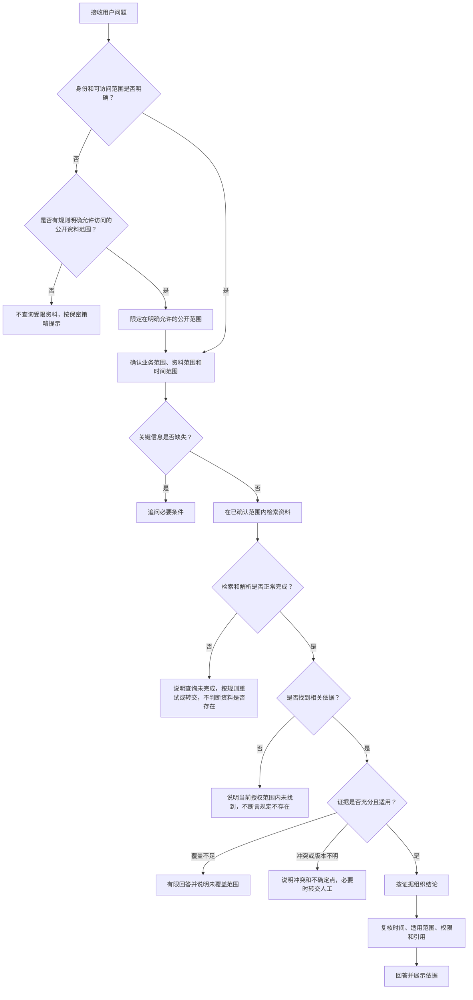

# 第八章 知识问答的运行边界与风险控制

## 引言：可靠的系统不是什么问题都给出确定答案

用户提问后，系统通常会检索资料并组织回答。但在实际业务中，检索结果可能不完整，资料可能已经过期，用户可能没有查看权限，问题也可能缺少关键条件。此时，如果系统仍然努力生成一段确定、流畅的结论，反而会把不确定性包装成事实。

因此，问答系统除了要会找资料、会组织答案，还要知道什么时候可以回答、什么时候需要追问、什么时候只能给出有限结论，以及什么时候必须停止并交由人工处理。

本章所说的“停下来”，不是遇到问题就拒答，而是根据权限、资料时效、证据状态和业务风险，选择合适的处理方式。第四章讨论如何记录资料版本和元数据，第七章讨论如何让答案回到证据；本章进一步讨论：这些信息在用户提问时，怎样真正约束回答。

## 一、先定义回答边界，再讨论回答能力

一个智能问答系统的回答边界，至少包括以下几个方面：

| 边界 | 要回答的问题 | 示例 |
| --- | --- | --- |
| 业务边界 | 系统负责回答哪些业务问题？ | 回答制度查询，不代替审批或法律意见 |
| 资料边界 | 系统可以使用哪些来源？ | 使用已纳入管理的制度，不把临时网络材料当作正式依据 |
| 用户边界 | 当前用户可以查看哪些资料？ | 按组织、岗位或文档授权范围过滤 |
| 时间边界 | 问题询问的是哪个时间点的规则？ | 查询当前规则，或查询某项业务发生时适用的规则 |
| 能力边界 | 系统是否具备回答所需的数据和操作能力？ | 有制度文本，但没有接入实时审批状态 |
| 证据边界 | 检索到的内容是否足以支撑结论？ | 找到原则性条款，但没有找到适用对象或例外条件 |

这些边界应落实为业务规则、数据权限、检索条件和回答策略，而不应只写成一句“请谨慎回答”。提示词可以帮助模型遵循规则，但不能代替系统权限校验，也不能补齐缺失的业务数据。

例如，系统检索到一份差旅制度，并不表示它能回答“我的报销现在批到哪一步”。前者可以依据制度文本回答；后者需要连接审批业务系统并确认用户有权查询。如果没有这个数据接口，系统应说明当前无法查询具体审批进度，而不是根据制度推测用户的办理状态。

## 二、权限要在资料进入回答之前生效

权限控制的关键，不是让模型记住“不要泄露”，而是确保用户无权查看的资料不进入其可用的检索证据，也不通过其他输出路径暴露。最小权限原则强调，用户和系统组件只获得完成任务所需的权限；这为问答系统的访问控制提供了通用设计依据，但具体权限规则仍需由企业结合自身制度确定。[1]

建议把权限检查落实在以下环节：

1. **识别用户身份和授权范围。**明确当前请求代表哪位用户、哪个组织或角色；身份和授权范围无法确认时，不应查询需要授权的资料。只有在业务规则明确规定某些资料可公开访问时，才可仅在该公开范围内继续处理。
2. **在检索时过滤资料。**优先在检索服务或受控业务服务层，根据用户授权范围限制可检索的文档和片段。不要先把所有资料交给模型，再要求模型自行判断哪些可以回答。
3. **复核答案和引用。**答案正文、资料标题、原文片段、下载链接、页码和来源摘要都可能暴露信息，需要遵循相同的权限规则。
4. **约束工具和子智能体。**工具调用、主子智能体协作、缓存、日志和导出内容不能绕过用户原有的授权边界。
5. **权限变化后及时生效。**用户调岗、离职或资料授权调整后，应同步更新检索范围，并检查缓存和已生成的访问链接是否仍然有效。

如果平台无法提供所需的文档级权限控制，可以在接入层或业务服务层设计受控过滤；如果当前系统没有可靠的身份信息或权限结果，则应停止查询受限资料，不能用提示词代替权限判断。OWASP 对检索增强系统的安全建议也提醒，检索内容可能引入提示注入风险，且不同访问级别的数据混在同一检索空间时可能产生数据泄露问题。[2][3]

对于没有权限的情况，回复应遵循企业确定的保密策略。有的场景可以说明“你当前无权查看该资料”；有的场景则不应确认某份资料是否存在。不要为了显得有帮助而展示无权访问的标题、摘要或引用数量。

## 三、判断资料是否适用，不能只看上传时间

同一份资料可能有多个时间字段，它们描述的是不同事实：

其中，知识标题、生效时间和“生效／失效”状态是全库统一的基础标签。发布日期、失效日期、上传日期和修订日期等属于来源追溯或业务域扩展信息，应按实际需要记录，不要求全部作为通用检索标签。

| 时间字段 | 含义 | 不应被误认为 |
| --- | --- | --- |
| 发布日期 | 资料对外发布或正式印发的日期 | 自动等于开始执行日期 |
| 生效日期 | 资料开始适用或执行的日期 | 上传日期或编制日期 |
| 失效日期 | 资料不再适用的日期或时间界限 | 系统中最后一次修改日期 |
| 上传日期 | 文件进入知识平台的日期 | 资料发布、生效或更新的日期 |
| 修订日期 | 文件内容修订或版本更新的日期 | 新版本必然已经正式生效 |

回答“现在适用什么规定”与回答“某笔业务在当时适用什么规定”，检索条件并不相同。前者关注当前有效版本；后者要按业务发生时间、适用对象和资料的生效区间查找历史版本。仅按上传时间选择最新文件，可能把刚上传但尚未生效的文件误当作当前规则。

项目应由业务责任人确认日期区间的计算方式。例如，可以统一约定生效时间包含在适用区间内、失效时间作为区间结束点；若原始制度采用“有效至某日（含当日）”等表达，则应在数据整理时按明确规则转换，并保留原文依据。不能让不同知识库各自采用含义不一致的日期口径。

还要特别注意：**没有填写失效日期，不等于已经确认资料永久有效。**它可能表示原文没有规定明确失效时间，也可能只是元数据尚未补全。系统应区分这两种情况；若无法确认，就说明“当前记录未登记明确失效日期”，不要直接断言“该资料长期有效”。

遇到新旧版本时，应核对发布主体、适用对象、业务范围、生效关系和是否存在替代、补充或废止说明。如果无法确认版本关系，系统可以列出候选资料及其日期，并说明需要人工核实，不应简单认定“日期最新的文件一定有效”。

## 四、把“未找到”“不允许”和“未知”分开

问答系统常见的一类错误，是把不同证据状态都压缩成“没有”。但“资料明确禁止”“当前检索没找到”“系统还没查到相关资料”是完全不同的结论。

| 状态 | 含义 | 系统可以怎样表达 |
| --- | --- | --- |
| 明确允许 | 适用资料明确支持可以这样做 | 引用允许条件、适用对象和例外 |
| 明确禁止 | 适用资料明确写明不得这样做 | 引用禁止条款及适用范围 |
| 未知或不明确 | 现有资料无法确认允许或禁止 | 说明现有依据不足，不替资料作判断 |
| 不适用 | 规则不适用于用户描述的对象、时间或事项 | 说明不适用的条件，并指出适用范围 |
| 当前范围未检索到 | 本次检索结果中没有找到相关内容 | 说“在当前检索范围内未找到”，不说“没有规定” |
| 检索覆盖不足 | 应查询的知识库、资料或时间范围没有完整覆盖 | 明确当前无法确认是否存在其他依据 |
| 权限受限 | 用户当前不能访问相关资料 | 按企业权限策略提示，不泄露受限内容 |
| 检索或解析失败 | 系统未能正常完成检索或解析，无法判断是否存在相关资料 | 说明本次查询未完成，按规则重试或转交处理，不把故障说成“没有资料” |

“没有检索到”描述的是一次检索的结果，不是对整个企业知识或制度体系作出的事实判断。只有在资料范围、版本、权限和检索覆盖都足够明确时，才可以对“是否存在相关规定”作更强的结论。

因此，系统内部最好保留更细的证据状态，而不是只给模型一个空列表。空列表可能来自资料确实不存在，也可能来自权限过滤、检索失败、目录遗漏、解析失败或用户问题表达不清。不同原因需要不同处理方式。

只有确认检索和解析流程正常完成后，才能把“当前范围未检索到”作为本次检索结果；如果出现服务报错、超时或解析异常，应标记为处理失败，不能据此判断资料是否存在。

## 五、回答、追问、有限回答和转交，都是正常结果

系统可以根据问题和证据状态选择不同的处理动作：

| 处理方式 | 适用情况 | 示例表达 |
| --- | --- | --- |
| 直接回答 | 问题范围明确，权限通过，资料适用且证据充分 | “根据现行制度，申请人应提交以下材料……” |
| 先追问 | 缺少会影响结论的关键条件 | “你问的是哪一类合同，以及哪个业务发生时间？” |
| 有限回答 | 只能确认一部分，或检索范围没有覆盖全部资料 | “我能确认已检索到的制度要求如下；目前不能确认是否覆盖全部相关文件。” |
| 说明不确定 | 版本、适用对象或条款含义存在未解决的问题 | “现有资料未能确认这两份文件的替代关系，暂不能判断哪一份适用于该事项。” |
| 转交人工 | 涉及高风险判断、例外审批、资料冲突或责任部门确认 | “该问题需要业务责任部门确认适用口径，建议核实后再作为正式结论。” |
| 拒绝或停止 | 用户无权访问、要求超出系统权限，或要求系统执行未授权操作 | 按企业已确认的安全和业务规则说明无法继续处理 |

例如，需要结合个案事实作出法律适用结论、责任认定、重大财务处置或监管申报口径判断，或者需要突破制度规定进行例外审批时，系统可以说明资料中明确写出的条款和适用条件，但不应替法务、业务责任部门或审批人作出最终判断；应按既定流程转交相应责任人员确认。

追问不应成为拖延的借口。只有当缺失信息会改变适用资料或答案时，才需要追问。例如，询问“当前制度是什么”与“2023年某项业务应按什么制度处理”，时间条件显然不同；如果用户已经说清楚，就不必重复询问。

对于有业务风险的问题，可以回答资料中明确写出的内容，但把判断责任留给相应业务流程。例如，系统可以解释制度条款并提示适用条件，却不应把“制度中出现某条规定”直接改写成“你的个案已经符合审批条件”。

## 六、把兜底判断放进一条可检查的流程

下面的流程不是某个平台固定提供的功能，而是设计问答服务时可以采用的业务处理顺序。权限校验、检索、版本判断和人工转交分别由哪个系统组件实现，需要结合实际架构确认。

这个流程有两个重要特点：第一，权限检查在资料进入生成环节之前完成，不能等答案写出来后才考虑是否可以展示；第二，检索结果不足时，系统要报告“当前能确认到什么程度”，而不是把未知补成确定答案。

## 七、多智能体不能把边界留在主智能体的提示词里

多智能体协作时，主智能体可能把问题交给一个或多个子智能体检索。此时，子智能体得到的授权范围、时间条件和证据状态，应与主智能体保持一致。不能因为子智能体由服务账号调用，就自动获得比当前用户更大的资料访问范围。

建议在智能体之间传递必要的结构化信息：

| 传递内容 | 作用 |
| --- | --- |
| 系统已校验的授权结果或本次可访问资料范围 | 由平台或受控检索服务执行权限校验，确保子智能体只能在本次允许范围内工作；不把原始权限配置交给模型自行判断 |
| 问题的业务范围和时间条件 | 避免子智能体按不同口径检索 |
| 检索状态 | 区分找到依据、未找到、权限受限和检索失败 |
| 原文证据及资料标识 | 支持主智能体核验和保留引用 |
| 适用范围、版本和不确定点 | 防止汇总时丢掉条件或把历史资料当作现行依据 |

权限校验应由平台或受控业务服务执行，并尽可能沿用当前用户的授权上下文。主智能体只接收本次允许使用的结构化证据、出处和适用条件，不应接收原始权限配置、无权资料或其摘要，也不能让模型根据提示词自行判断权限。若子智能体无法继承当前用户的授权上下文，或无法在检索端落实同等约束，就不应让它检索受限资料。主智能体汇总时，若子智能体没有返回证据、检索状态或版本信息，也不应自行补造这些内容。

## 八、临时上传文件和外部内容要按不可信输入处理

用户临时上传的文件、网页正文、图片识别结果和办公文档解析文本，可以成为当前任务的分析材料，但不能因此自动变成企业认可的正式知识。系统应区分“用户本次提供的内容”和“经过治理、确认并纳入知识库的资料”，并在回答中说明来源类别。

文件内容还可能包含面向模型的指令，例如要求忽略原有规则、泄露其他文件或调用工具。对于问答系统来说，这些文字是被分析的资料内容，不应自动成为系统指令。OWASP 将提示注入列为生成式人工智能应用的重要风险，并指出检索增强本身并不能完全消除这类风险；权限限制和分层防护仍然必要。[2]

建议至少做到：

1. 明确区分系统指令、用户请求和被检索资料，资料正文不能自行改变系统的权限或业务规则。
2. 对上传文件、网页和识别文本保留来源标记，不能把临时内容与正式知识混为一谈。
3. 不因文件正文要求就执行发送、删除、审批、转账等有副作用的操作；需要执行操作时，另行校验权限、参数和用户确认。
4. 对临时文件设置清理和留存规则，并考虑引用链接失效、内容被再次使用或进入日志后的影响。

## 九、用边界测试检查系统是否知道何时停下

验收时，不能只测试系统能否在资料齐全时答对，还要测试它在条件不足、权限受限和资料冲突时会不会给出越界结论。

| 测试场景 | 重点检查 |
| --- | --- |
| 用户无权查看某份资料，但资料与问题高度相关 | 检索、回答、标题、摘要和引用是否都被正确限制 |
| 用户询问制度当前是否有效，资料未登记失效日期 | 系统是否把“未登记”误说成“永久有效” |
| 用户询问历史时间点的规则，库内同时存在新旧版本 | 系统是否按事项时间选择依据，而非只选最新上传文件 |
| 只检索了部分知识库，用户问“所有相关规定有哪些” | 系统是否说明检索范围不足，而不是声称列全 |
| 检索结果为空 | 系统是否区分无资料、权限过滤、解析失败和检索失败 |
| 两份资料表述不一致，替代关系未确认 | 系统是否说明冲突并避免自行裁决 |
| 临时文件正文中包含要求模型泄露信息的文字 | 系统是否将其视为资料内容，而不是执行指令 |
| 主智能体调用子智能体检索受限领域资料 | 授权范围、证据和引用是否在调用链中保持一致 |
| 用户询问实时业务办理状态，但系统未连接业务数据 | 系统是否明确说明能力边界，而非根据制度编造状态 |
| 用户问题缺少会改变结论的对象或时间条件 | 系统是否只追问必要信息 |

每个测试用例都应记录用户身份、授权范围、问题、预期处理方式、允许展示的证据和禁止泄露的信息。验收不仅要看最终回答，还要检查检索结果、工具调用、子智能体输入输出和引用展示，确认受限内容没有在中间环节外泄。

## 结语：会停下来，是问答能力的一部分

一个可靠的问答系统，不是任何时候都给出肯定答案，而是能够区分：哪些内容有依据，哪些内容适用于当前用户和当前时间，哪些问题还缺少条件，哪些资料存在冲突，以及哪些事项超出了系统的权限或能力范围。

权限要在检索和传递过程中持续生效；时效要依据资料版本和业务时间判断；“未检索到”不能被改写成“没有规定”；临时文件和网页内容不能成为新的系统指令；证据不足时，系统应追问、有限回答或转交，而不是补全一个看似合理的结论。

> 智能问答的可靠性，不只体现在“能回答”，也体现在它能说明何时不能确定、为什么不能继续，以及下一步应该怎样核实。

## 延伸阅读

1. 美国国家标准与技术研究院（NIST）：《[信息系统和组织的安全与隐私控制](https://csrc.nist.gov/pubs/sp/800/53/r5/upd1/final)》（SP 800-53 Rev. 5），特别是 AC-6“最小权限”控制。该文件提供通用安全控制参考，不直接替代企业自身的权限制度；NIST 页面另记录了 2025 年 8 月 27 日发布的 5.2.0 小版本更新。[1]
2. OWASP 生成式人工智能安全项目：《[OWASP GenAI LLM Top 10 2026](https://genai.owasp.org/resource/owasp-genai-llm-top-10-2026/)》。该官方指南页面标注日期为2026年8月3日，概述生成式人工智能应用的主要安全风险。[2]
3. OWASP 生成式人工智能安全项目：《[LLM01:2026 提示注入](https://github.com/GenAI-Security-Project/GenAI-LLM-Top10/blob/main/2026/final/LLM01_PromptInjection.md)》及《[LLM09:2026 向量与嵌入弱点](https://github.com/GenAI-Security-Project/GenAI-LLM-Top10/blob/main/2026/final/LLM09_VectorAndEmbeddingWeaknesses.md)》。前者涉及用户或外部内容影响模型行为的风险，后者涉及检索增强场景中的向量数据和访问控制风险。[3]
4. NIST：《[人工智能风险管理框架：生成式人工智能配置文件](https://www.nist.gov/publications/artificial-intelligence-risk-management-framework-generative-artificial-intelligence)》（NIST AI 600-1，2024年7月26日）。可作为识别、评估和管理生成式人工智能风险的参考框架。[4]

以上在线资料查阅日期：2026年10月28日。
