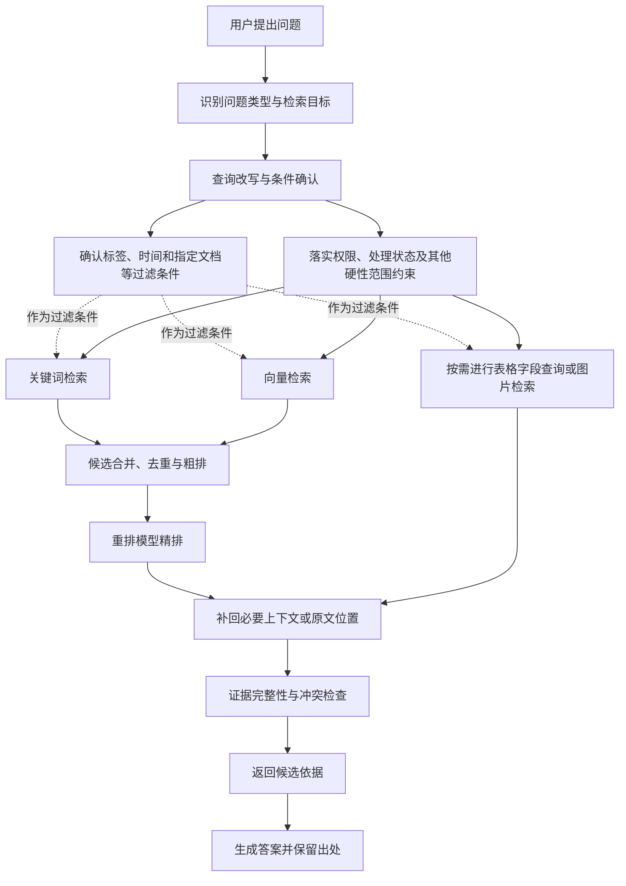

# 第六章 知识检索与证据筛选：混合召回、候选融合与重排

## 引言：检索返回了内容，问题还没有解决

当知识问答系统返回一段与问题相似的文字时，很多人会认为检索已经成功了。但“相关”只说明这段内容在主题、词语或语义上接近问题，并不说明它就是当前问题需要的依据，更不说明它包含了所有限制条件。

用户问“差旅报销需要哪些材料”，系统找到“差旅费用管理”几个字，并不能证明它找到了材料清单；用户问“某项规定是否适用于分公司”，系统找到规定正文，也不代表它找到了适用对象和例外条款；用户问“新旧制度有什么变化”，只召回新版本的一段文字，也无法完成版本比较。

检索真正要解决的，不是把相似文字送给模型，而是从允许使用的资料范围中，找到足以支持当前任务的证据。这个过程通常包括：理解问题、改写查询、混合检索召回、候选融合与粗排、重排精排、补回必要上下文，最后再进行证据核验。

本章不把某一种检索算法写成万能答案，而是解释不同环节分别解决什么问题，以及怎样判断问题究竟出在“没找到”“排在后面”“上下文不完整”，还是“资料本身无法支持这个结论”。

## 一、先区分四种“找到”

在排查问答问题时，可以把结果分成四种状态。它们看起来都像“检索有结果”，实际处理方式不同。

| 状态 | 说明 | 典型问题 |
| --- | --- | --- |
| 找到主题 | 找到谈论同一业务领域的内容 | 主题相关，但没有回答具体问题 |
| 找到片段 | 找到包含关键词或相似语义的片段 | 片段缺少条件、例外或上下文 |
| 找到依据 | 找到可以支撑某个具体结论的原文 | 还需要判断版本、适用范围和权限 |
| 找到完整依据 | 找到结论所需的主要规则、附件、限制和关联内容 | 才适合进入答案组织和引用核验 |

系统的检索评估，不能只统计“返回了多少片段”。更重要的是，相关问题需要的关键依据是否进入候选结果，排名是否足够靠前，片段是否能被完整理解，以及最终答案是否超出了这些依据能够支持的范围。

## 二、检索之前，先理解用户到底要找什么

同一句话可能对应不同的检索任务。用户问“偿付能力规定”，可能想要制度名称、定义、指标要求、当前有效版本，也可能是在询问某家公司的实际指标。前几类主要需要文档检索，最后一类可能需要业务数据或实时系统。

因此，检索之前应先判断问题的目标：

1. **查找资料。**用户想知道某份文件、某个条款或某个主题在哪里。
2. **解释规则。**用户想理解一项规定的含义、条件和办理方式。
3. **比较版本。**用户想知道新旧文件、不同制度或不同方案有什么变化。
4. **汇总案例。**用户想从多个文档中归纳共性、差异或风险表现。
5. **核对材料。**用户提供了具体材料，希望与规则进行对照。
6. **查询业务事实。**用户想知道审批状态、金额、记录或其他动态数据。

前五类可能主要依赖知识资料，但检索范围、证据数量和答案组织方式不同；第六类不能仅凭制度文档回答。若任务理解错误，后面的检索即使技术上正常，也可能把问题带到错误方向。

### 查询改写不是改变用户问题

用户口语可能不完整、使用简称或包含错别字。系统可以把问题改写成更适合检索的查询，例如补充已确认的业务主题、同义词和时间条件。但改写不能擅自添加用户没有提供的事实，也不能把不确定的猜测写成确定条件。

例如：

```text
用户问题：以前的差旅制度住宿标准是什么？
```

可以识别出“历史版本”“住宿标准”“差旅制度”这些检索方向，但如果用户没有提供具体年份、单位或事项发生时间，就不应自动把问题改写成某一个确定年份的查询。必要时应先追问，或者返回多个可能版本并说明区别。

查询改写的结果最好保留原问题和改写依据，便于后续排查。如果改写后召回了错误范围，不能只检查向量模型，还要检查是谁加入了错误的条件。

## 三、为什么需要混合检索

企业知识中的问题，既有需要精确匹配的内容，也有需要理解语义的内容。只使用一种检索方式，通常会在某一类问题上出现明显短板。

### 1. 关键词检索擅长匹配明确词项

关键词或全文检索适合召回包含明确词项的内容，例如：

- 制度正式名称、文号和条款编号；
- 专业术语、产品名称和机构名称；
- 金额、比例、日期、编号等具体内容；
- 用户明确提到的固定短语。

它的优势是能够利用用户明确给出的词语线索，但具体匹配和排序方式取决于平台的分词、字段和查询配置，不能一概视为逐字精确匹配。对文号、条款号、日期等必须严格一致的条件，应优先使用专门字段查询或精确过滤，并核对原文；一般全文检索仍可能受分词和相关性排序影响。关键词检索对同义表达、口语表达和概念改写也不够灵活。用户问“出差住宿能报多少”，资料中可能写的是“差旅期间住宿费限额”，仅依靠相同词语就可能漏掉相关内容。

### 2. 向量检索擅长理解相近含义

向量检索可以根据语义相似性寻找表达不同但含义接近的片段。它适合处理口语提问、同义表达、概念描述和跨句理解。

但语义相近不等于规则相同。两个片段都讨论“住宿费用”，一个可能是内部制度，另一个可能是行业案例；一个可能适用于总部，另一个只适用于下属机构。向量检索不应成为绕过来源、版本和适用范围判断的理由。

### 3. 两种结果需要统一融合

混合检索的意义，不是简单地把两个结果列表拼接起来，而是尽量兼顾精确词语和语义相关性。关键词结果能够找回正式名称和条款号，向量结果能够找回用户没有直接说出的相关表达；两者融合后，再交给后续排序环节判断。

不同资料类型可以采用不同的检索权重和测试重点，但不要先凭感觉固定一个比例。制度条款、案例材料、表格数据和长篇说明的词语分布不同，应通过真实问题比较漏召回、无关召回和排序位置。

## 四、从片段召回到答案生成，中间还需要两次排序

一个适合企业问答的多阶段流程，可以概括为：

> 混合检索召回 → 候选融合与粗排 → 重排模型精排 → 补回父级上下文 → 证据核验 → 生成带出处的答案

这里的“粗排”和“精排”不是重复做同一件事。

### 1. 召回：先尽量不要漏掉可能有用的内容

召回阶段的主要目标是扩大候选范围。系统可以从关键词检索、向量检索、标签过滤、指定文档查询或其他检索路径得到多个候选集合。

召回阶段不宜过早只保留极少数结果。某个片段在关键词路径中排名靠后，但在语义路径中很重要；如果一开始就删掉，后面的重排没有机会把它找回来。

但“多召回一些”也不是无限增加候选。候选过多会增加融合、重排和上下文处理负担，还可能把大量相似但不关键的片段带入答案生成。召回数量需要结合资料规模、问题类型、重排能力和响应要求调节。

### 2. 候选融合与粗排：把不同路径的结果放到一起比较

关键词和向量检索的分数含义可能不同，不能总是直接把两个分数相加。候选融合的任务，是把来自不同路径的结果合并、去重，并进行一轮相对粗略的排序。

一种常见的做法是根据片段在各自结果中的排名进行融合，例如使用排名融合方法。这里不必把某个方法当作唯一选择，重点是理解它解决的问题：同一片段如果在多个检索路径中都出现，通常应获得更高的候选优先级；只在单一路径中出现、但排名很靠前的片段，也不应被简单丢弃。

以倒数排名融合（RRF）为例，它根据片段在各个结果列表中的名次累计融合分数，而不是直接把不同检索器的原始分数相加。简化形式可以写作：`RRF(d) = Σᵢ 1 / (k + rankᵢ(d))`。其中 `rankᵢ(d)` 表示片段 `d` 在第 `i` 个结果列表中的位置，`k` 是平滑参数。它的作用是融合多个排序结果，不是判断原文是否真实、是否现行或是否适用于用户。RRF 是一种常见方法，不代表所有检索系统都使用它，也不保证在每个数据集和任务上都优于其他融合方式。[1][2]

粗排阶段还可以考虑资料类型、时间、主题和版本等已确认属性，但不能用业务猜测替代正文证据。权限和硬性范围应在候选进入后续阶段前落实，不能等答案生成时才临时遮挡。

### 3. 重排精排：判断候选是否真的回答当前问题

重排模型会同时阅读用户问题和候选片段，重新判断片段与问题的相关程度。它可以补充关键词数量或向量距离等初筛信号，但不能保证识别全部条件、语义关系和问题意图，效果仍需用本企业的问题和资料验证。

从接口形式看，常见重排服务会接收一个查询和一组候选文本，并返回按相关程度重新排列的结果；这是对候选集合再排序，并不负责从整个知识库中发现所有可能相关的资料。[3]

重排也不是事实核验器。它可以判断“这段话是否更像是在回答问题”，但不能凭相似度证明资料来源权威、版本当前有效或业务结论成立。重排分数高，只说明它适合进入后续阅读，不代表可以直接写成答案。

重排候选过少，可能漏掉真正依据；候选过多，会增加处理时间和资源消耗，并让多个相似片段争夺有限的上下文空间。应记录进入重排的候选数量、最终保留数量和问题类型，避免只看一个综合分数。

### 4. 父子块：用小片段找，用大上下文答

有些文档适合用较小的子片段进行精确检索，但答案理解又需要上级章节、完整条款或前后文。这时可以采用“子块召回、父块回填”的思路：先用子块提高命中精度，再根据片段与文档结构的关系，补回父级上下文。

例如，子块命中了“住宿费限额”这一句，父块可能包含适用人员、地区差异和例外条件。只把子块交给模型，容易得到一个脱离条件的数字；补回必要父块后，模型才更可能正确理解这项标准。

这些父子关系应来自第五章文档处理时保存的知识块编号、父块编号和章节路径，而不是在检索阶段让模型临时猜测。表格、图片文字和图片描述也应能关联到所属表格、原图和上级正文。回填时仍需校验权限、版本和处理状态，不能因为子块可见，就把无权查看或未经复核的父级内容一起交给模型。

父块回填也要有边界。不能因为命中一个词，就把整份几百页的文件全部塞进上下文；应根据章节路径、条款关系和问题需要补回相邻内容，并避免重复片段。

### 5. 正文、表格和图片：检索入口不同，取回的依据也不同

第五章产生的不只是普通文本片段，还可能包括表格结构化数据、表格摘要、列描述、图片文字、图片描述；部分平台和模型还支持按需使用图片向量。检索策略需要承接这些不同类型的结果，而不是把它们都当作同一种段落。

| 内容类型 | 可以使用的检索入口 | 命中后还要核对什么 |
| --- | --- | --- |
| 正文与图片识别文字 | 关键词或文本向量检索 | 章节上下文、识别质量及原文位置 |
| 表格摘要与列描述 | 按表格主题、字段含义进行文本检索 | 对应的结构化行列、数值、单位和原表位置 |
| 结构化表格数据 | 在指定工作表和字段范围内查询 | 筛选条件、行列对应、合并表头、脚注和数据范围 |
| 图片描述 | 按描述文本进行关键词或语义检索 | 原图、所在页、图片区域及与正文的关系；描述只是辅助信息 |
| 图片向量（可选） | 仅在平台、模型和检索链路支持时，按图像或图文相似性检索 | 原图、所在页、图片区域及与正文的关系；向量相似度不构成文字证据 |

表格摘要适合帮助系统找到“可能存有答案的表”，不适合替代逐行查询。涉及求和、比较或比例计算时，应先从结构化数据中取出正确字段，再通过受控的查询或计算工具处理；检索和重排本身不能保证计算正确。

图片描述是模型生成的辅助信息，可以帮助找到相关图片，但不能单独替代原图或正式原文。涉及图中数字、箭头关系或具体步骤的结论，应回到原图及经过核对的识别内容检查，不能把描述与原图当作两份相互独立的证据。

这些路径按问题需要启用，并不意味着每次查询都同时搜索所有内容类型。图片向量是第五章所述的可选能力，是否可用须按平台、模型和检索链路确认。具体能否查询表格字段、使用图片向量或返回原图，仍要以实际系统接口为准；没有相应能力时，应保留可人工核验的位置，并说明回答限制。

## 五、检索流程图：每个环节解决不同问题

下面的流程图展示从用户问题到候选证据的主要路径。它不是某个平台的固定实现图，具体节点可以根据系统能力组合或调整。



图中权限、处理状态与其他硬性范围约束用于限定可检索范围；标签、时间、指定文档等条件通常作为关键词或向量检索的过滤条件，不是天然独立的一路召回结果。结构化表格查询和图片检索则是按需启用的专门路径，未必经过通用文本重排，需按平台实际实现核验结果。不同平台可能把这些能力组合在内部节点中，业务设计上仍应分清各自作用，不能由生成模型临时猜测权限或硬性条件。

处理状态用于限制尚未完成或未经复核的内容进入候选集合，不代表资料的业务效力。不同检索路径合并候选时，还应保留内容类型、资料及版本编号、父子关系和原文定位，不能只留下文本与相关性分数。这样重排后的表格片段才能回到正确工作表和单元格，图片片段也能回到原图，而不是在答案生成时再尝试补出处。

## 六、不同问题需要不同的检索策略

### 1. 指定文档问题：优先定位，不要扩大范围

用户明确说出文件名、文号或条款号时，系统应优先在指定资料和相关版本中定位。若直接对全部知识库做宽泛语义检索，可能找到同主题但不是用户指定的文件。

指定文档不存在、标题不完整或存在多个版本时，应向用户确认，或列出候选文件并说明差异。不能因为找到一份相似标题的资料，就假定它就是用户所说的文件。

### 2. 主题查询：混合检索更有价值

用户问“企业在理赔方面常见的风险有哪些”，可能没有明确的文件名和术语。关键词检索可以找“理赔风险”“责任认定”等固定表达，向量检索可以找“赔付审核不充分”“材料核验不到位”等不同说法。此类问题通常需要先召回多个相关片段，再通过主题和资料类型筛选。

### 3. 时间和版本问题：时间条件不能只靠语义相似

用户问“2024 年发生的事项适用哪个规定”，需要关注事项时间、制度生效时间、失效时间和版本关系。一个包含“2024”的片段不一定是适用于 2024 年事项的制度；它可能只是后来文件对历史情况的描述。

时间条件应尽量通过结构化字段和正文关系共同判断，不能只依靠向量距离或文件上传时间。

### 4. 比较问题：两边都要召回

用户问“新旧制度有哪些变化”，系统至少需要确定要比较的两个对象，再分别召回对应版本。只召回当前版本并让模型“推测变化”，不能算完成比较。

比较结果还应说明比较范围。没有找到旧版某项内容，不等于旧版没有这项内容；可能是旧版未入库、解析失败或检索条件不完整。

### 5. 跨文档问题：先找依据，再组合结论

用户问“多个监管通报中反复出现的问题有哪些”，需要从多个资料中分别找到案例事实，再进行归纳。系统不能只找到一份最相似文档，就把它概括成行业普遍规律。

跨文档答案应保留每个结论对应的资料范围，并区分“多个文档共同支持的现象”和“单个案例中的特殊情况”。这也是后续引用和溯源章节需要重点处理的内容。

## 七、多知识库检索：并行不等于更快、更准

当资料被拆成多个知识库时，需要明确一次问题实际检索了哪些库。

### 1. 只检索一个相关库

如果问题可以可靠地路由到一个库，候选范围可能更小，结果也更容易解释。但路由本身需要时间和判断；如果问题实际跨越多个业务范围，单库路由可能导致漏召回。

### 2. 同时检索多个库

平台可能并行查询多个范围，再对结果合并；也可能采用其他内部调度方式。无论实现方式如何，系统都需要处理多个结果集合、去除重复内容并统一排序。去重时应保留资料标识、版本、片段标识和来源定位；不能仅因两段文字相似就合并，以免混淆不同版本、来源或适用范围。确认是重复副本时，也应保留各自必要的来源和权限记录。

如果每个库都返回一批候选，进入重排和答案生成的内容可能增加；如果平台设置了全局候选上限，又可能导致某个库的结果被过早截断。多库检索不是天然更快，也不是天然更准，必须观察实际调用链和结果质量。

### 3. 如何判断拆分是否带来收益

不要只比较知识库数量，应比较：

- 每个问题实际查询了几个库；
- 各库分别返回多少候选片段；
- 合并、去重和重排前后的候选数量；
- 关键依据是否因为路由或截断而漏掉；
- 总响应时间中，检索、合并、重排和生成各占多少；
- 跨库问题的答案是否还能保留完整出处。

如果拆库只是把一个检索请求变成多个并行请求，而问题仍然查询所有资料，就不能把“并行”直接说成性能提升。并行可能缩短等待时间，也可能因资源竞争增加较慢请求的延迟；最终要看实际负载和平台实现。

## 八、候选数量和上下文长度需要共同控制

检索系统通常同时面对两个限制：候选片段太少会漏依据，候选片段太多会增加排序和阅读负担。

可以把候选管理分成三层：

1. **召回候选。**尽量覆盖可能相关的片段，允许不同检索路径提供候选。
2. **重排候选。**保留足够数量交给重排模型判断，但排除明显无关和越权内容。
3. **生成上下文。**只把最能支持当前答案的片段及必要上下文交给生成模型。

三层数量不必相同。召回阶段可以多一些，重排后应减少，最终上下文还要考虑片段之间是否重复、是否包含冲突以及能否支撑完整结论。

不能用“把所有召回内容都放进模型”解决漏召回问题。过多内容会让模型更难判断重点，重复内容可能造成虚假的一致感，互相冲突的版本可能被混合成一段没有依据的结论。

## 九、检索分数不是业务结论

关键词分数、向量相似度、融合排名和重排分数，都是帮助系统排序的技术信号，不是制度效力、业务合规或事实真实性的证明。

以下几种情况都可能出现高分但不能直接使用：

- 文字相似，但适用单位不同；
- 主题相同，但一个是旧版本；
- 术语高度重合，但回答的是另一个问题；
- 案例描述与当前规则相似，但案例只是历史事实；
- 片段单独看很相关，但上文或附件包含限制条件；
- 资料来源不明，却因为表达清晰而获得高排名。

因此，排序完成后仍需要做证据检查：资料是否允许使用，版本是否适用，片段是否完整，结论是否超出原文。检索系统应把“为什么排在前面”和“能否作为依据”分开记录。

## 十、检索失败时，先判断失败发生在哪一层

同样是“答案不准确”，原因可能完全不同。

| 表现 | 可能原因 | 排查方向 |
| --- | --- | --- |
| 没有返回任何相关片段 | 解析失败、查询改写错误、过滤过严或资料未入库 | 查文件状态、查询条件和过滤日志 |
| 有相关片段但排在后面 | 召回路径单一、排序信号不合适或候选数量太少 | 比较关键词、向量和重排结果 |
| 片段相关但答案遗漏条件 | 切片过小、父级上下文未回填或附件未关联 | 查看片段结构和上下文关系 |
| 返回内容混入其他业务 | 目录、标签或路由范围过宽 | 检查知识范围和过滤条件 |
| 版本混在一起 | 生命周期和版本关系未治理 | 检查生效、失效和替代关系 |
| 检索结果正确但答案仍错误 | 模型组合或引用环节出错 | 查看最终输入和答案证据对应关系 |
| 跨库问题遗漏一部分 | 路由只选择一个库或全局候选被截断 | 检查多库调用和合并过程 |

排查时不要一上来就修改模型。先保存同一问题的原始输入、改写问题、过滤范围、各路召回结果、融合排序、重排结果、最终上下文和答案出处，才能知道错误发生在哪里。

## 十一、用真实问题验收检索链路

检索验收至少应包括以下问题类型：

| 问题类型 | 验收重点 |
| --- | --- |
| 正式标题或条款号查询 | 能否准确定位指定资料和条款 |
| 口语化主题查询 | 能否通过语义检索找到不同表达的相关内容 |
| 包含专业词、数字和日期的问题 | 关键词路径是否保留精确匹配能力 |
| 带权限和目录条件的问题 | 是否先限制在允许范围内 |
| 一般规则加例外条件的问题 | 是否同时召回限制和例外条款 |
| 新旧版本比较 | 是否两边都找到，并标明版本关系 |
| 多文档汇总 | 是否区分共同现象和单个案例 |
| 跨知识库问题 | 是否完整调用相关范围并保留出处 |
| 无依据或条件不足的问题 | 是否追问或说明证据不足，而不是编造结论 |

每道测试题建议记录：预期依据、允许使用的资料范围、关键片段、必须出现的条件、不能出现的结论和出处要求。这样评估的不是“回答像不像”，而是检索是否找到足以支撑答案的证据。

### 需要重点观察的指标

- **关键依据召回率@K：**在测试题预先标注必需依据后，检查前 K 个候选中召回了多少项必需依据，并除以必需依据总数；用于观察答案是否可能因漏召回而不完整。
- **排序质量：**检查关键依据是否排在靠前位置；可同时记录首个关键依据的名次，或使用考虑相关程度和位置的排序指标。
- **无关片段比例：**候选中有多少内容只是主题相似而不是问题相关。
- **条件完整率：**一般规则、限制、例外和适用对象是否一起出现。
- **跨文档覆盖率：**需要多个资料时，是否覆盖了各个必要来源。
- **出处保留率：**最终采用的内容是否能回到原始资料位置。
- **时延和资源：**检索、融合、重排和生成分别耗时多少。

这些指标应结合业务场景解释。一个只需要定位单条制度的场景，和一个需要跨十份案例总结共性风险的场景，不能用同一个候选数量和同一套答案标准。

检索指标衡量的是候选是否找全、排得是否合适；它们不等同于最终答案质量。还应单独检查答案中的关键结论是否被引用原文支持、限制条件是否完整、资料版本是否适用。测试时应固定问题集、预期依据和相关性判断口径，再比较配置变化前后的结果，避免只凭少数案例或单一分数下结论。

## 十二、检索策略不是一次配置永久不变

资料增加、目录调整、用户问题变化和模型更新，都可能改变检索结果。一个刚开始效果不错的配置，面对新的文档类型或新的业务场景，可能出现漏召回、重复召回和版本混用。

因此，建议为不同资料和场景建立可调整但有记录的策略：

1. 记录使用了哪些检索路径和查询改写规则。
2. 记录召回、融合、重排和最终上下文的数量配置。
3. 记录哪些字段参与过滤，过滤是硬性限制还是辅助排序。
4. 记录问题类型与典型失败案例。
5. 每次调整后，用固定测试集比较准确性、完整性、出处和时延。
6. 重要变更保留版本，避免出现“现在为什么和上个月不一样”却无法解释的情况。

调参不能只追求一个更高的相关性分数。候选更多可能提高召回，却增加无关内容；重排更严格可能减少噪声，却漏掉表达不典型的依据；上下文更长可能保留更多条件，也可能让答案更难组织。最终应以具体场景是否得到可核验答案为判断标准。

## 结语：检索的目标不是找到最多，而是找到足够支持答案的依据

检索系统不是资料搜索框的简单升级。它需要理解问题，覆盖不同表达，保留精确术语，合并多个路径的候选，再从中筛出真正能支撑当前任务的内容。

混合检索解决“不要只依赖一种找法”，候选融合和粗排解决“把不同路径找到的内容放在一起比较”，重排精排解决“判断哪些片段更像是在回答当前问题”，父块回填解决“不要让片段脱离上下文”。但这些环节都不能替代权限、版本和证据核验。

> 找到相关内容只是检索的开始；只有找到适用、完整、可定位、足以支撑当前结论的依据，系统才真正接近可靠回答。

## 延伸阅读

1. G. V. Cormack、C. L. A. Clarke、S. Büttcher：《[Reciprocal Rank Fusion outperforms Condorcet and individual rank learning methods](https://doi.org/10.1145/1571941.1572114)》，SIGIR 2009。RRF 方法的原始论文。
2. Microsoft Learn：《[Hybrid Search Scoring (RRF)](https://learn.microsoft.com/en-us/azure/search/hybrid-search-ranking)》。用于了解一个具体搜索产品如何解释混合检索结果与 RRF；产品实现示例不等于所有平台的通用行为。
3. Cohere 文档：《[Rerank API v2](https://docs.cohere.com/reference/rerank)》。用于了解一种重排服务的查询与候选文本接口；该服务的限制和能力不应直接推断为其他模型的行为。
4. 美国国家标准与技术研究院（NIST）TREC：《[Common Evaluation Measures](https://trec.nist.gov/pubs/trec10/appendices/measures.pdf)》。用于核对信息检索中查全率、查准率等常见指标的定义；指标仍需结合具体任务设计测试集和判断标准。

以上在线文档查阅日期：2026 年 10 月 27 日。产品文档可能更新，实际配置应以所用平台和模型版本为准。
