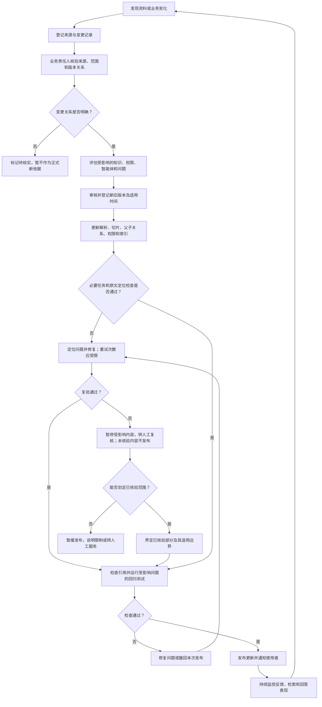

# 第十一章 知识更新与持续治理机制

## 引言：上传完成，只代表流程开始

一份资料成功上传，系统完成了解析和索引，用户也能检索到它——这只能说明资料进入了问答系统，不代表它以后一直正确、适用或完整。

制度可能修订，业务流程可能调整，资料责任人可能变化，曾经有效的版本可能被替代。即使原文件没有任何变化，组织范围、权限、使用场景和用户需求也可能已经变了。知识库若只负责“把文件收进去”，却没有人负责确认它何时需要更新、何时应退出当前回答范围，系统就会逐渐积累过时信息，并继续用流畅的语言重复它们。

知识管理标准把知识管理描述为需要建立、实施、维护、评审和持续改进的管理体系，而不是一次性的资料整理活动。[1] 对智能问答来说，这意味着上传、解析、切片、索引和回答都要放在持续治理的闭环里；资料进入知识库以后，仍然需要责任人、版本关系、复核机制和退出机制。

第四章讨论资料来源与版本，第十章讨论如何检验系统表现；本章把两者连接起来，聚焦资料发生变化后，如何更新知识库、验证答案并让责任人持续跟进。

## 一、把知识更新当成业务流程，而不是文件操作

常见的知识更新方式是：有人发现新文件，上传到平台，然后认为系统已经更新。实际中，至少还需要回答以下问题：

- 新文件由谁发布，是否为正式来源？
- 它是替代旧文件、补充旧文件，还是只适用于一类对象或一段时间？
- 旧版本从什么时候起不再用于当前问题？是否还要保留历史查询？
- 新文件是否成功解析，表格、附件和条款结构有没有丢失？
- 标签、权限、知识目录、智能体范围和引用定位是否同步更新？
- 更新后，之前能正确回答的典型问题是否仍然答对？

只要这些关系没有确认，单纯上传最新文件就可能造成新旧版本并列、旧规则继续被召回，或者新文件虽然存在却未进入实际检索范围。

知识库中的“正确”至少包括四个层次：

| 层次 | 要确认的问题 | 例子 |
| --- | --- | --- |
| 来源正确 | 资料来自被认可的发布主体吗？ | 是否为正式印发版本，而不是征求意见稿 |
| 内容正确 | 文件完整、解析结果准确吗？ | 表格、附件和脚注是否被正确读取 |
| 通用状态标签正确 | 当前适用版本是否标为“生效”，已被替代且不再适用的版本是否标为“失效”？ | 新版已生效，但旧版仍标为“生效”并混入当前检索 |
| 使用正确 | 资料被放入了正确范围，权限和时间条件正确吗？ | 历史版本只用于历史事项查询 |

这四层中任何一层出错，都可能让一个“已成功入库”的文档产生错误答案。

## 二、先明确谁对知识负责

平台管理员通常能看到文件是否上传成功、索引是否构建完成，但不一定有资格判定制度是否仍然有效。知识维护也不应落在一个没有业务权责的“万能管理员”身上。

| 角色 | 主要责任 | 不宜代替谁做判断 |
| --- | --- | --- |
| 业务知识责任人 | 确认内容权威性、适用范围、版本关系和业务解释 | 不能仅凭平台状态判断业务规则 |
| 知识维护人员 | 登记资料、元数据、目录、版本和维护记录，推动复核 | 不应自行裁定专业内容是否有效 |
| 平台或数据运维人员 | 确保解析、索引、权限同步、备份和运行状态 | 不应擅自改变资料的业务含义 |
| 智能体负责人 | 维护问答范围、路由、工具、引用规则和回归测试 | 不应自行确认制度或法规的效力 |
| 合规、法务或风险责任角色 | 按企业规定审核高风险资料和特殊问题 | 不能用技术评测代替专业审核 |
| 使用部门 | 反馈过时内容、错误引用和回答缺口 | 用户反馈本身不自动成为正式规则 |

小型项目中，一个人可以兼任多个角色；但角色责任仍要区分。尤其要避免“上传的人默认就是内容审核人”或“系统能检索到就证明资料有效”。

## 三、变化从哪里来：不能只等用户指出错误

知识更新需要多个触发来源，至少包括：

1. **正式变更事件。**责任部门发布修订、补充、废止、替代或适用范围调整通知。
2. **定期复核。**对长期未更新、使用频繁或风险较高的资料，按业务确认的周期检查责任人、来源、状态和适用范围。
3. **系统信号。**检索失败增加、用户频繁追问、引用指向旧版本、同类问题答案不一致，可能提示资料或配置需要检查。
4. **业务变化。**组织架构、岗位职责、审批流程、产品范围或服务对象发生变化，可能使原资料不再适用。
5. **外部来源变化。**主管机构、行业组织或外部合作方发布新内容时，应及时发现并核验来源、正式程度和适用范围。
6. **问题反馈与审核发现。**用户纠错、人工复核、投诉或抽样检查可以触发调查，但不应未经核实直接修改知识。

周期复核不能代替事件触发。若资料在两次例行检查之间已经发生正式变更，等到下一个复核日才处理仍可能太迟。反过来，外部网页发生更新，也不意味着企业应立即把新内容自动发布为正式知识。

复核周期应按资料风险、变化频率和业务影响确定，而不是所有文档统一规定每年检查一次。对于变化快或影响大的内容，可建立明确的事件通知和较短处理目标；对稳定资料，可以采用较长复核周期，但仍要保留责任人和到期提醒。

## 四、版本关系要明确，不能靠上传时间推断

一份新资料与旧资料之间，可能是不同的关系：

| 关系 | 含义 | 处理要点 |
| --- | --- | --- |
| 替代 | 新资料整体或部分取代旧资料 | 确认替代范围和生效时间，旧版退出当前问答范围 |
| 补充 | 新资料增加说明或细化要求，但原资料仍部分适用 | 说明补充关系和适用条款，避免只检索其中一份 |
| 修正 | 对已发布内容的错误进行更正 | 保留更正记录，确认原版是否还可作为历史事实查询 |
| 并行适用 | 两份资料针对不同主体、区域、产品或业务 | 把适用对象写清楚，不能简单二选一 |
| 暂行或尚未到生效时间 | 文件已发布，但需要满足日期或条件后才适用 | 作为后台治理事项记录；确认适用前不进入当前问答范围，不扩充通用状态标签 |
| 废止或被替代 | 资料不再适用于新的业务事项 | 通用状态标签更新为“失效”；如有需要，保留受控历史查询 |
| 关系未确认 | 资料之间的效力或替代关系没有可靠依据 | 标记待核实，不交给模型猜测版本关系 |

“发布时间较新”“上传时间较晚”都不能单独证明一份文件已经替代旧文件。资料的正式效力和适用关系，应由有权的业务责任人根据正式来源、条文说明和企业规则确认。

知识库通用状态标签只使用“生效”和“失效”。“待审核”“待核实”“待发布”或“尚未到生效时间”等属于后台治理流程记录，不作为第三种、第四种检索标签；“由哪个版本替代”则应记录为版本关系。不同版本可以保留在同一个知识库中，逐份维护知识标题、生效时间和状态：当前适用版本为“生效”，已被替代的旧版本为“失效”。检索当前问题时过滤“生效”版本；历史问题再结合事项时间和版本关系检索旧版。只写“最新文件”或只看上传时间，都不足以确认适用关系。

## 五、让更新经过一条可追踪的处理链

对每次重要更新，可以按以下顺序处理：

1. **登记变更。**记录发现时间、来源、提交人、涉及资料和变更原因；不要直接覆盖原文件。
2. **核验来源。**确认发布主体、正式程度、完整性和适用范围；外部网页或用户转发文件先标记为待确认。
3. **判断变更关系。**由业务责任人说明这是替代、补充、修正、并行适用还是废止，并确认生效时间。
4. **评估影响。**列出受影响的知识片段、标签、目录、智能体、常见问题、引用和评测样本。
5. **审核内容。**根据风险确定业务、法务、合规或其他角色是否需要复核；记录审核结论和责任人。
6. **处理新旧资料。**登记新版本，更新状态和时间关系；旧版本按历史查询策略保留或从当前检索中排除。
7. **重新处理并验证。**按变更范围重新解析、切片、维护父子关系并更新索引，检查权限、元数据、引用和必要任务状态；不能只看平台显示“导入成功”。
8. **运行回归问题。**用受影响的典型题、表格和图片题、边界题及旧版本问题，验证内容处理、取数、引用和新旧版本区分是否正确。
9. **发布并告知。**在完成必要审核后发布，通知相关维护人员和使用部门，并记录何时开始对用户生效。
10. **观察与回退。**监控新版本使用情况；出现重大问题时，能够停止使用错误索引、恢复到已核验版本或临时转人工。

建议用统一的变更记录承接上述流程，至少留存以下信息：

| 记录项 | 需要记录的内容 |
| --- | --- |
| 资料与版本 | 资料标识、旧版和新版的版本信息，以及原始文件位置 |
| 变更依据与关系 | 正式来源、变更原因，以及替代、补充、修正或并行适用关系 |
| 适用范围与时间 | 适用对象、业务或地区范围，以及生效、失效时间 |
| 影响范围 | 受影响的目录、权限、智能体、常见问题和评测题 |
| 责任与审核 | 提交人、业务确认人、所需专业审核角色及审核结论 |
| 处理与验证 | 解析和索引处理情况、配置或任务版本、回归测试结果及未通过项 |
| 发布与回退 | 面向用户的生效时间、通知对象，以及暂停或回退条件和处理方式 |

这里的“重新处理”不是简单地把文件再上传一次。正文、表格或图片发生变化时，应沿着第五章的处理链，更新受影响的解析结果、知识片段、父子关系、摘要、向量和索引，并清理不再适用的旧内容。只变更权限或业务标签时，则按依赖关系更新相应配置，不必机械地重做整个知识库。文件版本、解析器及配置版本、任务编号、失败原因、重试结果和人工复核记录应分别保留，便于定位错误来自资料还是处理过程。

表格和图片处理可能异步完成，主流程结束不代表相关子任务全部成功。发布前应核对必要任务、原文定位和关联关系；关键内容失败或仅部分完成时，应先重试、修复或人工复核，不能直接作为依赖这些内容的高风险回答依据。已经核验的部分可以在明确范围后使用，但必须告知缺失部分，不能暗示整份资料已被完整读取。

技术回退还要服从业务适用关系。如果新版已经生效、旧版已经不再适用，不能因为新版尚未处理完成就继续把旧版作为当前依据；应暂停受影响的回答、说明限制或转交人工，直到新依据可用。

## 六、保留历史，不等于让旧版本继续参与当前回答

有些项目为了避免遗漏，会把新旧文件一直堆在知识库里。这样做保留了资料，却没有管理它们之间的关系。系统可能同时召回新旧要求，让模型自行选择，最后把不同版本拼成一段答案。

比较稳妥的做法是把“资料留档”和“资料参与当前问答”分开：

- 当前适用资料进入默认的当前问答范围；
- 已被替代、废止或超过适用期的资料从默认当前检索范围退出；
- 有历史查询需求时，按用户问题中的时间条件进入受控的历史资料范围；
- 无法确认版本关系的资料标记为待核实，不和已确认的现行资料混在一起；
- 原始文件、审核记录和替代关系按企业档案与留存要求保存，不能因为知识库下线就随意删除。

**示例：**某企业的差旅办法 2024 版规定了一套住宿标准，2026 版在 2026 年 7 月 1 日起生效并调整了部分标准。维护时不应简单覆盖文件，也不应让两个版本无标识地同时参与当前检索。应记录新版的适用日期和具体替代范围；询问 2026 年 8 月的差旅事项时使用新版，询问 2025 年发生的事项时再按历史规则查询。该示例为版本治理演示，不代表任何真实制度。

## 七、更新后，受影响的不只是文档索引

一份资料变化，可能影响多个环节：

| 影响对象 | 可能需要检查的内容 |
| --- | --- |
| 文档解析 | 页面级识别、表格结构、附件、脚注和章节是否正确提取，原文位置是否保留 |
| 表格与图片衍生内容 | 结构化表格、摘要、列描述、图片文字、图片描述和图片向量是否与新原文一致 |
| 知识片段 | 旧切片是否残留，新切片是否丢失上下文或例外，父子知识块是否重新关联 |
| 处理任务与复核记录 | 解析器及配置版本是否留档，异步任务是否完成，失败重试及人工复核是否有结果 |
| 标签和元数据 | 标题、目录、责任部门、状态、生效和失效日期是否更新 |
| 权限配置 | 新版本是否继承了正确权限，旧版本权限是否仍适用 |
| 检索与排序 | 新版是否能被相关问题召回，旧版是否被错误排到前面 |
| 智能体配置 | 知识库范围、场景说明、路由规则和回答要求是否受影响 |
| 引用与链接 | 引用是否定位到正确版本、章节、工作表、单元格或图片区域 |
| 缓存与副本 | 旧回答、摘要、导出内容或中间缓存是否继续被使用 |
| 评测集 | 是否新增需要覆盖的条件、例外和历史时间问题 |
| 用户沟通 | 需要告知谁更新了什么、从何时开始适用 |

因此，更新记录最好能从原始资料一路关联到对应版本、解析结果、知识片段、索引构建、评测结果和发布记录。这样出现问题时，维护人员才能回答：“哪些答案可能受到这次变更影响？”

更新后的回归也不能只检查“新文件能不能搜到”。受影响的表格要验证字段、数值、单位和计算范围；图片要验证关键文字、数字及图中关系；父子知识块要验证上下文回填和出处定位；版本问题要同时检查当前查询与历史查询。即使源文件没有变化，更换解析器、识别模型或切片配置后，也应针对这些结构敏感问题重新验证，防止技术升级悄悄改变知识含义。

## 八、外部信息可以监测，但不能无审核地自动变成权威知识

企业会使用法规网站、行业公告、合作方通知和公开研究资料。自动监测可以帮助发现页面变化、文件更新或新公告，但“发现变化”与“确认可以用于企业问答”是两件事。

在正式入库前，至少应确认：

1. 来源是否为原始发布渠道，转载页面是否完整；
2. 文件属于正式发布、征求意见、解读材料还是新闻介绍；
3. 适用主体、地区、业务范围和时间条件是什么；
4. 新内容是否真的替代旧内容，还是只补充部分事项；
5. 企业是否已确定由哪个责任部门维护和解释。

对需要高可信度的资料，可以采用“自动发现、人工核验、受控发布”的方式。自动化适合减少漏看，不应在未确认来源和效力关系时，自动把网页正文改成已生效的企业规则。

## 九、衡量更新治理是否有效

更新治理不只统计“本月上传多少文件”，还要观察资料是否有人负责、变化是否及时处理、旧版本是否退出当前检索，以及更新后系统有没有重新验证。

| 指标 | 建议计算口径 | 使用时注意 |
| --- | --- | --- |
| 责任人覆盖率 | 有明确内容责任人的在管资料数 ÷ 在管资料总数 | 固定统计时点和资料范围；责任人应具备业务确认职责，而非只有平台账号 |
| 复核逾期率 | 超过约定复核期限且尚未完成复核的资料数 ÷ 本统计周期内到期应复核资料总数 | 逾期表示需要检查，不自动等于资料已失效；分母为零时标记为“不适用” |
| 更新处理时长 | 从业务确认变更到新版通过验证并可正确检索的耗时 | 按变更事件统计，建议同时报告中位数和第95百分位；按风险等级设目标 |
| 旧版误召回率 | 过期版本进入最终检索上下文的当前问题数 ÷ 需要使用现行资料的测试问题数 | 单独统计最终答案是否误用旧版；历史查询题不计入该分母 |
| 更新处理通过率 | 解析、切片、索引及关键内容核验均通过的更新资料数 ÷ 完成本次处理的更新资料总数 | 按资料计数；平台任务显示成功不等于内容质量合格 |
| 变更回归通过率 | 通过的受影响评测题数 ÷ 实际执行的受影响评测题总数 | 注明测试范围；对严重问题单独报告，不能被平均值掩盖 |
| 待确认资料数量 | 统计时点上来源、版本关系或状态尚未核实的资料数 | 同时记录责任人、发现时间、待确认原因和处理状态 |
| 反馈闭环时长 | 从反馈登记到完成核实、修复或给出解释的耗时 | 按反馈事件统计，建议同时报告中位数和第95百分位 |

这些指标是治理工具，不是为了制作一个看起来漂亮的仪表盘。指标应帮助团队发现责任缺口、更新延迟和反复出现的错误；若指标不能触发具体处理，就需要重新设计。

## 十、常见的更新陷阱

- **只上传新文件，不标注替代关系。**结果是新旧版本一起被召回，模型需要猜哪份有效。
- **直接覆盖旧文件。**可能失去历史追溯依据，无法回答过去某个时间点适用什么规则。
- **只按上传日期选最新。**文件上传得晚，不等于发布日期或生效日期更晚。
- **只看导入成功提示。**解析错误、附件遗漏、权限配置不完整和索引滞后仍可能发生。
- **所有资料使用同一复核周期。**变化快、风险高的资料可能检查太晚，稳定资料又可能产生无效维护负担。
- **把用户差评直接当成知识更正。**差评是调查线索，不是正式业务口径。
- **只重建索引，不检查答案。**索引更新成功不能证明系统的版本判断、引用和回答都正确。
- **把历史文件全部删除。**这可能破坏审计、档案留存和历史事项查询需要。
- **没有回退方案。**错误版本发布后无法快速撤回，问题会持续影响用户。
- **认为模型会自行发现知识已过期。**模型只能使用当前提供给它的信息和状态，不能替企业确认最新制度。

## 结语：知识治理的终点不是入库，而是持续可用

知识更新不只是文件替换，而是一次需要业务确认的变更管理：确认来源，判断版本关系，评估影响，更新权限和索引，重新验证问题，再正式发布并持续观察。没有责任人、时间关系和变更记录，系统就无法可靠地区分“当前可用”“历史可查”和“尚待确认”。

知识管理体系强调评审和改进；AI系统的部署后监测也需要关注功能、运行、人机交互、安全与合规等方面。NIST 2026 年的监测报告指出，部署前测试无法完全覆盖真实环境中的变化和非确定性，部署后监测仍是发现问题和反馈改进的重要环节；同时，统一、成熟的监测方法仍在发展中。[2][3]

> 知识库不会因为有了新文件就自动变得更正确。只有当每次变化都有来源、有责任、有版本、有验证，也有退出和回退机制，知识才会持续可靠地服务于问答。

## 延伸阅读

1. 国际标准化组织（ISO）：《[ISO 30401:2018 知识管理体系——要求](https://www.iso.org/standard/68683.html)》及《[ISO/DIS 30401 第二版项目页](https://www.iso.org/standard/89436.html)》。截至2026年10月28日，ISO 30401:2018 仍列为已发布标准，第二版草案正在制定。该标准从管理体系角度覆盖建立、实施、维护、评审和改进；此处用于说明治理思路，不代表标准规定了具体的智能问答技术流程。[1]
2. Anita Rao 等：《[Challenges to the Monitoring of Deployed AI Systems](https://doi.org/10.6028/NIST.AI.800-4)》，NIST AI 800-4，2026年3月。梳理人工智能系统部署后监测的类别、实践挑战和待研究问题。[2]
3. NIST：《[人工智能风险管理框架生成式人工智能配置文件](https://doi.org/10.6028/NIST.AI.600-1)》（NIST AI 600-1，2024年7月）及《[NIST AI RMF Playbook](https://www.nist.gov/itl/ai-risk-management-framework/nist-ai-rmf-playbook)》的建议，可作为风险管理、反馈处理和持续改进的参考。[3]
