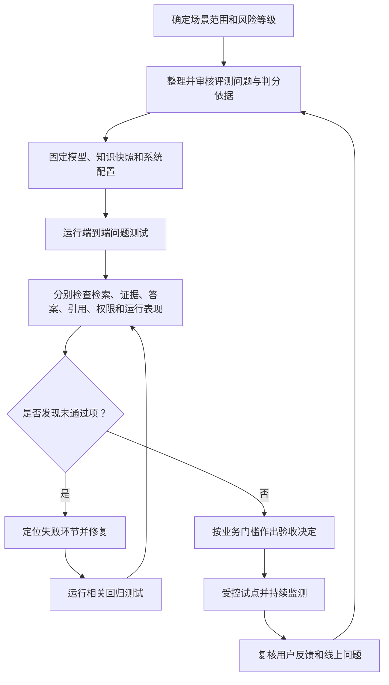

# 第十章 知识问答系统的评测、验收与运行监控

## 引言：演示能答，不等于系统能用

一场演示中，智能体回答了几个准备好的问题，语气自然、格式整齐，看起来像是“已经做好了”。但真实用户会换一种说法，会问资料中没有的问题，会把不同时间、对象和条件混在一起，也会遇到权限不足、资料冲突和检索失败。系统在演示中答得顺，不等于它能在这些场景里稳定、负责地处理。

验收不是给答案打一个“像不像”的分数，而是判断系统能不能在约定的业务范围内，找到适用资料，依据证据作答，在不确定时正确追问或停止，并且不越过权限和责任边界。

本章给出一套从问题样本、评测维度、人工核验到上线监测的验收方法。它不要求所有企业采用同一套指标或分数，而是帮助项目团队把“我觉得还不错”改成可讨论、可复现、可追责的判断。

## 一、先说清楚验收的对象是什么

一个知识问答系统不是只有最后生成答案的模型。用户能看到的回答，是多个环节共同作用的结果：问题理解、场景路由、权限过滤、资料检索、候选排序、证据组织、答案生成、引用展示，有时还包括业务工具调用和人工复核。

如果只看最终回答，即使发现错误，也很难知道原因：是资料没有入库，还是切片时丢了条件？是检索没找到，还是排序把正确片段排后了？是证据正确但模型总结错了，还是引用链接指向了错误版本？

因此，验收需要同时观察两个层面：

| 验收层面 | 要回答的问题 | 例子 |
| --- | --- | --- |
| 端到端效果 | 用户拿到的结果是否正确、完整、可用、可追溯？ | 是否回答了问题中的全部条件，并提供支持结论的出处 |
| 环节表现 | 哪个步骤造成成功或失败？ | 正确资料是否被召回，权限过滤是否生效，引用是否保留 |

端到端效果决定系统对业务是否有帮助；环节表现帮助团队找到应该修复的地方。只看过程指标，可能出现“召回率很好但最终答错”；只看最终答案，又可能把偶然答对误认为系统可靠。

## 二、先建立一套真实的问题评测集

评测集是验收用的问题样本及其判断依据。它不应只是研发人员临时编写的“标准题”，而应尽可能代表真实用户会问什么、哪些错误后果较大，以及系统承诺处理到什么范围。

### 1. 问题从哪里来

可以从以下来源整理样本：

- 用户实际咨询记录、客服工单和业务群中的常见问题；
- 业务人员培训、制度宣贯和新人答疑中反复出现的问题；
- 知识维护人员基于现有资料整理的典型问题；
- 上线试点期间用户改写、追问、点踩或转人工的问题；
- 专门设计的边界问题，例如资料冲突、无答案、权限受限和时间版本问题。

真实问题可能包含个人信息、合同内容或内部经营信息。整理样本时应按企业要求脱敏、控制访问范围，并避免为了做评测而把敏感数据扩散到不受控的工具或文件中。

### 2. 问题要覆盖不同难度和失败模式

建议至少覆盖以下类型：

| 问题类型 | 样例方向 | 主要检查 |
| --- | --- | --- |
| 直接查询 | 某个制度规定了什么？ | 能否找到直接、明确的原文依据 |
| 条件问题 | 某类人员在某种情况下需要哪些材料？ | 对象、条件、例外是否都完整 |
| 多步问题 | 按规定先做什么、再由谁处理？ | 多个片段是否按正确关系组织 |
| 跨资料问题 | 两份规定分别怎样要求，差异是什么？ | 是否分清来源，而不是混为一谈 |
| 时间版本问题 | 某个历史时间点适用哪个版本？ | 是否按事项时间判断，不只看上传时间 |
| 含糊问题 | “这个能不能报？” | 是否追问决定答案的必要条件 |
| 无答案问题 | 资料没有说明某个细节 | 是否承认当前依据不足，而不是猜测 |
| 权限问题 | 用户询问其无权查看的资料 | 是否阻止检索和引用泄露 |
| 冲突问题 | 多份资料给出不同要求 | 是否指出冲突并按规则处理 |
| 临时文件问题 | 用户上传文件后询问内容 | 是否标明来源类别，不把它冒充正式知识 |
| 扫描资料问题 | 图片型 PDF 中某项金额、日期或否定条件是什么？ | 关键数字、否定词和阅读顺序是否识别正确 |
| 表格取数问题 | 某年度、某项目的数据是多少，按指定范围合计是多少？ | 表头、行列、单位和取数范围是否正确，计算是否可核验 |
| 图表流程问题 | 流程图中先做什么，分支条件是什么？ | 是否保留箭头、分支和先后关系，而不是只提取文字 |
| 部分处理失败问题 | 附件表格尚未处理完成，能否回答依赖它的问题？ | 是否提示限制、只回答已核实部分或转人工，不假装读过缺失内容 |
| 路由问题 | 主题相近但所属场景不同 | 是否调用正确的知识范围或子智能体 |
| 故障问题 | 检索超时、工具失败或部分知识库不可用 | 是否如实说明限制，不伪装成完整查询 |

问题不应全部是“资料中有一个句子，答案也抄这句话”。企业用户关心的往往是条件、例外、步骤、版本、责任人和跨文件关系；评测集若没有这些题型，最终分数再漂亮，也不能说明系统能处理真实业务。

### 3. 每道题都要有可核验的判分依据

生成式问答通常允许不同的正确表达，因此不必把唯一标准答案写成一段不可变的文字。更实用的做法，是为每道题记录：

| 记录项 | 内容 |
| --- | --- |
| 问题和必要上下文 | 用户原问、角色、事项时间、对象等影响答案的条件 |
| 预期处理方式 | 直接回答、追问、有限回答、拒答或转交 |
| 可接受依据 | 正式资料名称、版本、条款或片段位置 |
| 必须覆盖的要点 | 结论、适用对象、条件、步骤、例外或时间范围 |
| 不允许出现的内容 | 无依据推断、旧版本结论、越权信息或误导性承诺 |
| 评分说明 | 如何判断正确、部分正确、错误以及严重程度 |
| 责任确认人 | 熟悉该业务和资料效力的审核角色 |

对高风险问题，可以让两位业务审核人员分别判断，记录分歧后再形成统一口径。分歧本身有价值：它可能说明制度表达有歧义、知识维护口径不一致，或验收标准尚未明确。

## 三、把“答得好”拆成能定位问题的维度

RAG评估研究通常会分别观察检索上下文是否相关、答案是否忠于上下文，以及答案是否回应了问题。ARES 等研究框架也将这些维度分开评估，并使用人工标注校准自动评价，以减少单靠模型裁判产生的误差。[1][2]

企业验收可以在此基础上增加业务、权限和运营维度：

第五章涉及的文档处理能力也要单独验收。“文件上传成功”只能证明文件已被接收，不能证明解析、表格和图片处理、索引已经完成，更不能证明资料已经适合回答当前业务问题。若系统承诺处理表格、图片或扫描文档，就应把相应样本纳入验收，而不是只测试容易读取的正文。

| 维度 | 核心问题 | 常见失败表现 |
| --- | --- | --- |
| 解析完整性 | 约定范围内的正文、页面、附件和关键内容是否正确提取？ | 漏页、乱码或漏掉附表，但任务仍显示成功 |
| 内容类型分流 | 正文、结构化表格、图片和图表是否按内容特征处理？ | 所有内容都压成连续文字，丢失结构 |
| 表格结构与可计算性 | 数值能否对应到正确的字段、行列、单位和范围？ | 摘要提到了表格，却无法可靠取数或计算 |
| 图片识别与图意 | 关键文字、数字、否定词及图中关系是否正确保留？ | 文字识别出来了，但箭头顺序或条件理解错误 |
| 父子关系与原文定位 | 命中片段后能否恢复必要上下文并返回原文位置？ | 找到局部文字，却无法回到所属条款、原表或原图 |
| 处理状态 | 是否区分完成、部分完成、失败和需人工复核，并据此限制使用？ | 图片任务失败，资料仍被当作已完整处理 |
| 问题理解 | 系统是否理解用户要问什么、缺少什么条件？ | 把“历史适用”当成“当前适用” |
| 路由与范围 | 是否查询了应该查询的知识范围？ | 漏掉专业场景，或不必要地调用所有知识库 |
| 检索覆盖 | 支持答案的关键资料是否被找回来？ | 相关条款没有进入候选结果 |
| 排序质量 | 最有用的证据是否排在前面？ | 正确资料被大量相似但不适用的片段淹没 |
| 证据充分 | 证据是否足以支持答案中的每个关键结论？ | 只找到原则，没有找到条件和例外 |
| 答案正确 | 关键事实、数值、对象和关系是否正确？ | 数字写错、条件漏掉或把建议说成规定 |
| 忠于证据 | 答案是否超出检索到的内容？ | 用模型常识补全资料没有说的规则 |
| 回答相关与完整 | 是否正面回应问题，并覆盖需要的内容？ | 只讲背景，不回答用户真正的问题 |
| 引用质量 | 引用是否真实存在、位置正确且确实支持对应结论？ | 有文件名但引用段落不支持结论 |
| 边界处理 | 无答案、冲突、权限受限时是否采取正确动作？ | 没找到却断言“没有规定” |
| 运行表现 | 延迟、失败率、调用量和资源成本是否可接受？ | 平均速度可以，但高峰时频繁超时 |

### 常见量化指标及口径

下表提供可选的统计口径，不要求所有项目使用完全相同的指标。关键是测试前明确样本、分母、统计范围和判定规则，并同时报告数量与比例，避免一个总分掩盖具体问题。

| 指标 | 建议口径 | 统计注意事项 |
| --- | --- | --- |
| 证据召回率（Recall@K） | 标注为必要的证据片段中，出现在检索结果前 K 条的片段数 ÷ 必要证据片段总数 | 固定 K；必要证据由业务人员事先标注；另看关键证据是否缺失 |
| 关键结论证据支持率 | 有正确出处且原文确实支持的关键结论数 ÷ 所有需要证据支持的关键结论数 | 检查出处定位和结论支持关系，不能只看答案是否带了引用 |
| 完整答对率 | 按判分表正确覆盖全部必答要点、条件和例外的问题数 ÷ 评测问题总数 | 部分正确应单独统计，不要与完全正确合并 |
| 正确停答率、误拒率 | 正确停答数 ÷ 应停答问题数；误拒数 ÷ 应回答问题数 | 两个指标分开报告，避免只追求少答或只追求多答 |
| 端到端响应时长（P95） | 按端到端响应时长从低到高排序，取第 95 百分位 | 同时报超时、失败和重试情况，并注明测试负载与统计周期 |

这些指标要结合具体问题类型解读。例如，整体证据召回率较高，不代表关键条款都找到了；平均答对率较高，也不能抵消越权泄露或重大事实错误。

“忠于证据”和“事实正确”不是同一件事。如果检索到的是过期资料，模型可能忠实复述了过期资料，但对当前问题仍然答错；如果答案恰好正确，却没有依据支持，也不能把它视为可靠的知识库回答。

同样，“答案相关”也不等于“答案完整”。用户问办理条件，系统回答了相关背景，却漏掉必要的例外条款，仍然不能算通过。评价表应标明哪些信息是必须覆盖的，哪些属于可选补充。

## 四、先查文档处理，再查检索和生成

排查问题时，先确认原始内容有没有被正确处理，再问系统有没有找到依据，最后问模型有没有正确使用依据。否则团队容易把所有错误都归因于模型，反复修改提示词，却没有修复内容缺失、结构损坏或检索遗漏。

### 文档处理侧检查

把原始资料与处理结果对照，而不只是检查最终答案：

- 必要页面、附件、表格和图片是否齐全，空白页与漏识别是否被正确区分？
- 数字、日期、否定词、条款编号及阅读顺序是否与原文一致？
- 表格是否保留字段、单位、行列和脚注，能否按测试条件取出正确数据？
- 图片文字、图片描述和原图是否正确关联，流程箭头及分支是否有可靠依据？
- 父子知识块、章节路径和原文位置是否可回连，失败任务是否被拦截或进入复核？

### 检索侧检查

对每道题，业务审核人员可以先标注“哪些资料片段足以支持答案”。然后检查系统是否把这些片段召回，以及它们在排序结果中的位置。

- **召回覆盖：**应该找到的依据有没有进入候选集合？
- **前排质量：**最关键的依据是否排在用户可见或模型实际使用的前列？
- **噪声比例：**前列是否塞入大量主题相近但不适用的材料？
- **范围完整：**问题涉及多个知识库或子智能体时，是否遗漏了某个必要来源？
- **权限和版本：**召回结果是否属于当前用户可以访问、且适用于所问时间的资料？

### 生成侧检查

在确认关键证据已进入上下文后，再检查模型是否正确组织答案：

- 是否只陈述证据支持的结论？
- 是否保留对象、时间、条件、例外和限制？
- 是否把不同文件的观点归属到正确来源？
- 是否区分原文规定、系统归纳和建议？
- 是否在证据不足时追问、有限回答或转交？

如果原始表格中的数字在解析结果里已经错位，应先修复文档处理；如果处理结果正确但关键证据没有被召回，再检查切片、标签、查询改写、过滤条件、召回数量和排序方式；如果正确证据已进入模型上下文而答案仍错，再检查上下文组织、生成提示词、模型输出格式和引用映射。分别记录文档处理错误、检索错误和生成错误，一次只调整少数变量并做回归测试，才能知道修复是否有效。

## 五、引用与拒答也要纳入验收

引用不能只检查“答案后面有没有文件名”。至少要检查四件事：来源真实存在、引用定位正确、原文支持对应结论、版本和适用范围正确。若答案包含多个结论，应抽查每个关键结论与出处之间的对应关系。

拒答和追问也应设置正反两类测试：

| 测试方向 | 示例 | 通过表现 |
| --- | --- | --- |
| 应该回答时不误拒 | 资料中有明确答案，用户条件也完整 | 按依据作答，不用泛化免责声明代替答案 |
| 应该停下时不乱答 | 资料缺失、冲突、过期或用户无权查看 | 说明限制、追问或转交，不编造确定结论 |
| 应该追问时问对问题 | 用户遗漏会改变结论的对象或时间 | 只询问影响判断的必要条件 |
| 应该引用时不漏引 | 答案中出现制度要求、日期或数值 | 提供能支持这些说法的资料位置 |

如果系统为了避免错误而对所有问题都回答“请联系人工”，它当然可能减少某些错误，却没有完成问答服务的目标。因此要同时衡量“该答而答”和“该停而停”，并把两者分开记录。

## 六、不要让自动评分替代业务判断

自动评测可以帮助批量比较不同版本、发现明显退化、筛出待人工复核的样本。它尤其适合做回归检查和变化趋势观察。但自动分数不是业务正确性的证明。

ARES 研究将上下文相关性、答案忠实度和答案相关性分开评价，并使用少量人工标注辅助校准模型裁判；RAGAS 研究也强调，检索上下文质量、对上下文的忠实使用和最终答案质量需要分别观察。[1][2] 这些方法可以作为评测设计参考，但实际效果会受到评判模型、提示词、题目类型和业务领域影响。

建议把自动评测放在“筛查和比较”位置：

1. 用人工确认过的题目和标准建立初始评测集。
2. 选择与当前业务目标对应的自动指标，不为追求一个漂亮总分而堆叠指标。
3. 用一批人工判断样本检查自动裁判是否与业务人员口径一致。
4. 对法律、财务、风险、权限等高影响问题保留人工抽检或专项审核。
5. 自动评分异常或模型版本变化时，回看原始问题、检索证据和答案，不只看分数曲线。

NIST 的人工智能风险管理框架强调在系统设计、开发、使用和评估过程中持续考虑可信性；它提供的是风险管理参考框架，并不规定某个RAG项目必须达到一个通用分数。[3] 因此，企业应结合业务风险定义自己的通过条件，而不是把某一论文指标或工具默认阈值当成普遍验收标准。

## 七、建立问题严重程度，而不是只算平均分

平均分会掩盖关键错误。比如，九十道简单题都答对，一道越权泄露或金额判断错误，平均准确率仍可能很好看；但对业务来说，这一道严重问题可能就足以阻止上线。

可以把问题按影响分级：

| 等级 | 典型问题 | 建议处理 |
| --- | --- | --- |
| 严重 | 越权披露、错误法律或财务结论、捏造关键条款或版本 | 作为上线阻断项，修复并重新验证相关场景 |
| 重要 | 漏掉关键条件、引用错误、跨资料结论归属不清 | 评估影响范围，完成针对性修复和回归测试 |
| 一般 | 表达不清、格式不一致、次要背景遗漏 | 纳入体验改进，观察是否影响用户决策 |

每类问题的严重程度应由业务责任人、安全或合规相关角色共同确认。对高风险用例，可以要求关键项必须通过，而不是允许它被大量低风险题的高分抵消。

验收门槛应在正式测试前确定，至少写清各业务场景的关键指标及口径、样本范围、不可接受的问题、通过或限制范围试点的条件，以及负责确认的角色。越权披露、捏造关键依据、重大法律或财务结论错误等，可按项目风险设为上线阻断项；其他质量和性能门槛则由业务结合风险、用户规模和运行要求确定，不套用一个所谓通用分数。

## 八、做版本对比时，要保证比较公平

当团队更换模型、提示词、知识切片方式、检索参数、重排模型或路由逻辑时，需要知道新版本到底改善了什么、又引入了什么退化。

较公平的对比通常需要：

1. 固定同一批测试问题、用户权限、知识快照和资料版本。
2. 记录模型、提示词、索引、检索参数、工具配置和代码版本。
3. 尽可能一次改变一个主要变量，或明确记录组合变更。
4. 对有随机性的模型设置重复运行或抽样复核，避免把一次偶然结果当成稳定提升。
5. 同时查看整体指标、分场景结果和严重错误，不只看平均分。
6. 将用于调优的问题与用于最终验收的问题分开，避免系统只记住测试题的表达方式。

一个可重复的验收闭环可以概括为：先固定范围和样本，再运行系统、定位失败、修复并做回归；达到业务设定的门槛后再试点，上线反馈继续补充评测样本。

回归测试也不应只检查新增功能。修改一个知识库的路由或提示词，可能影响其他场景；更新全局模型，也可能改变拒答、引用或工具调用行为。关键边界用例应持续纳入每次发布的检查范围。

## 九、上线以后，验收并没有结束

用户的问题会变化，资料会更新，权限会调整，模型和平台组件也可能升级。上线前的测试只代表某个版本、某个知识快照和某个时间点的表现，不能证明系统以后一直可靠。

建议持续关注：

- 用户问题类型和业务范围是否发生变化；
- 检索结果为空、超时、路由失败和工具失败是否增加；
- 低评分、追问、重试、转人工和用户纠正是否集中在某些主题；
- 权限、版本和引用错误是否出现；
- 知识更新后，历史高频问题是否仍能找到正确依据；
- 模型或配置升级后，答案质量和运行成本是否出现明显变化。

用户点赞、点踩和转人工记录可以作为风险信号，但不能单独当作准确率。用户可能因语气不满意而点踩，也可能没有发现一个看起来合理但依据错误的答案。对重要反馈，应回到问题、检索结果和引用原文进行复核。

监控和日志也要遵循隐私与权限要求。记录足够定位故障的信息，不代表可以无边界地保存完整对话、敏感文件或受限原文；保存期限、访问角色和脱敏方式应由企业治理规则明确。

## 十、用一份验收记录把结论留下来

每次重要验收，可以留存一份简明记录，避免结论只存在于会议演示或个人印象中：

| 项目 | 记录内容 |
| --- | --- |
| 被测版本 | 模型、提示词、知识快照、索引和工具配置的版本信息 |
| 测试范围 | 场景、用户群体、知识库和不覆盖的内容 |
| 样本说明 | 问题数量、题型分布、数据来源、脱敏情况 |
| 结果摘要 | 各维度表现、分场景结果和严重问题数量 |
| 典型失败 | 原始问题、检索证据、最终答案、失败环节和影响 |
| 遗留风险 | 已知限制、不能回答的场景和人工兜底方式 |
| 验收决定 | 通过、限制范围试用、整改后复测或暂缓上线 |
| 审核责任 | 业务确认、安全或合规审核、技术验收的责任角色 |

“限制范围试用”也是一种有效结论。它意味着系统只在某些用户、问题和资料范围内使用，同时明确哪些问题仍要交给人工，而不是把局部可用宣传成已经全面可靠。

## 结语：验收要证明边界内可靠，而不是演示时表现不错

智能问答系统的验收，既要看答案是否正确，也要看依据是否找对、引用是否支持结论、权限是否生效、证据不足时是否会停下，以及上线后的表现能否持续观察。检索质量、答案质量、边界行为和运行成本应分别检查，再结合业务风险形成结论。

一套好的评测集不是为了让系统拿高分，而是为了尽早暴露真实风险。它要保留难题、无答案问题和失败案例；每次重要变更后都能重复运行；出现问题时还能回到原始问题、证据和处理环节定位原因。

> 验收的目标不是证明系统什么都能答，而是证明它在约定范围内有依据地回答，在范围之外诚实地说明限制。

## 延伸阅读

1. Jon Saad-Falcon、Omar Khattab、Christopher Potts、Matei Zaharia：《[ARES: An Automated Evaluation Framework for Retrieval-Augmented Generation Systems](https://aclanthology.org/2024.naacl-long.20/)》，NAACL-HLT 2024。研究分别评估检索上下文相关性、答案忠实度和答案相关性，并探讨使用少量人工标注校准自动评估的方法。[1]
2. Shahul Es 等：《[RAGAs: Automated Evaluation of Retrieval Augmented Generation](https://aclanthology.org/2024.eacl-demo.16/)》，EACL 2024 Demo。讨论检索增强问答的自动评估，并区分检索上下文质量、答案对上下文的忠实程度和生成答案质量。[2]
3. 美国国家标准与技术研究院（NIST）：《[人工智能风险管理框架：生成式人工智能配置文件](https://www.nist.gov/publications/artificial-intelligence-risk-management-framework-generative-artificial-intelligence)》（NIST AI 600-1，2024年7月26日）。作为生成式人工智能风险识别、评估和管理的参考框架；它不提供适用于所有企业问答系统的统一分数门槛。[3]

以上在线资料查阅日期：2026年10月28日。
