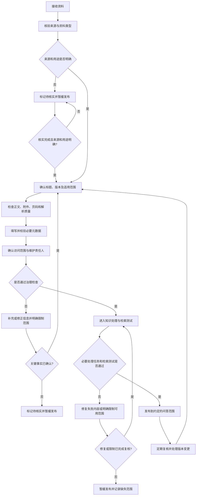

# 第四章 文档治理与元数据管理：来源、版本及适用性

## 引言：文件进入平台，不等于它已经成为可靠知识

把文件上传到知识库，只完成了资料进入系统的一步。系统也许已经能解析它、切分它、检索它，但这些动作并没有自动证明：文件来源可信、内容是当前适用版本、附件没有遗漏，或者它适合支持用户正在问的那个问题。

有时，答案找不到，不是因为模型不够聪明，而是标题只写着“制度最新版”、正文没有发文单位、扫描件漏掉了关键页，或者旧版和新版同时参与检索却没有说明替代关系。模型只能处理它收到的内容，无法凭空补齐没有记录的版本关系和管理事实。

因此，文档治理不是上传前的整理杂务，而是问答可信度的一部分。本章讨论怎样确认资料来源和版本，怎样处理附件、重复件和冲突件，以及哪些元数据值得维护。这里的“元数据”是描述资料及其管理状态的信息；它能帮助人和系统理解资料，但不能把未经确认的事实变成真相。

## 一、先分清文件内容、文件属性和治理记录

一份文件中可能同时存在正文、封面、页眉、附件和扫描图像；管理系统还会保存文件名、上传时间、目录等信息。它们看起来都与文档有关，实际含义不同。

| 信息类别 | 示例 | 能说明什么 | 不能单独证明什么 |
| --- | --- | --- | --- |
| 正文内容 | 制度条文、流程说明、案例事实 | 文档表达了什么内容 | 文件目前仍然有效、来源已核实 |
| 文件属性 | 文件名、格式、大小、上传时间 | 这份电子文件的基本情况 | 正式标题、发布日期、适用范围 |
| 业务元数据 | 发文单位、文号、资料类型、业务目录 | 资料由谁发布、属于什么类别 | 内容一定正确或适用于当前问题 |
| 治理记录 | 审核人、核验日期、版本关系、业务状态确认记录 | 企业如何确认和维护这份资料 | 未经实际核验的内容准确无误 |

例如，一个文件名叫“2026最新报销制度.pdf”，只能说明上传者使用了这个文件名。它本身不能证明文档由哪个部门发布、何时生效，或者是否已替代之前版本。

治理的目标不是把每份文件变成一张字段齐全的表，而是让关键问题有可靠答案：这份资料从哪里来？适用于什么范围？和其他版本是什么关系？当前是否允许用于回答？由谁维护？

## 二、先确认来源，别让文件名替资料背书

资料来源决定了它可以被如何使用。制度、法规、内部操作说明、经验案例和用户临时上传文件，不能因为都能解析成文字，就被当成同一种证据。

导入前，至少需要确认以下信息：

1. **来源主体是谁。**记录实际发布或形成资料的部门、机构或组织；无法确认时标为待核实。
2. **资料通过什么渠道取得。**区分内部正式系统、责任部门提供、外部公开渠道、邮件或个人转交等情况。来源主体和获取渠道应分开记录。
3. **资料属于什么类型。**例如制度、办事指南、正式通知、公开案例、内部复盘或会议材料。“草稿”属于资料状态，不是资料类型。
4. **有没有可核对的标识。**例如正式标题、文号、发布机构、原始链接或系统记录编号。不同资料类型可核实的标识不同，不要求所有文件都具备同一组字段。
5. **是否完成业务确认。**需要业务责任人确认的，记录确认状态和时间；不能把“已上传”当成“已审批”或“已确认”。
6. **资料当前是否适用。**知识库使用的通用状态标签统一为“生效”和“失效”。草稿、待核实、尚未发布或尚未到生效日期等属于资料治理流程状态，不扩充为第三种标签；未完成核验或尚不适用的资料，不进入当前问答检索范围。

来源权威性不能只靠一条固定排序解决。对于某个问题，正式发布的规则可能是主要依据；内部流程说明可能帮助解释如何办理；经验案例可以帮助了解过去发生过什么，但通常不能单独证明当前规则。具体要根据问题类型和企业确定的依据规则来判断。

尤其要区分三项确认结果：

- **来源已知**：能够确认资料的发布或形成主体及取得渠道，并保留可追溯信息。
- **内容已核验**：责任人员已按约定范围检查资料完整性、关键内容及其与原始材料的一致性，并记录核验范围和结果；仅确认来源，不等于内容已核验。
- **业务已确认**：有权责任人确认它可在指定业务范围内使用。

这三者相关但不等同。来源已知，不一定内容正确；内容已核验，不等于已确认业务效力或适用范围；内容可读，也不代表业务已确认。

## 三、版本管理要记录关系，不只是记录日期

企业资料常有修订、补充、替代、重发和历史保留。若只保留一个“上传时间”或“发布日期”，系统很难判断两个文件之间的关系。

至少要区分以下时间概念：

| 时间字段 | 表示的含义 | 不应混同为 |
| --- | --- | --- |
| 发布日期 | 文件由发布方正式发布或对外公布的日期 | 文件上传日期、生效日期 |
| 生效日期 | 文件开始适用或执行的日期 | 发布日期、扫描入库日期 |
| 失效日期 | 文件明确停止适用或失效的日期；空值不应被自动解释成永久有效 | 最新日期、替代日期 |
| 事件发生日期 | 案例、业务事项或统计数据实际对应的时间 | 文件发布日期、知识更新时间 |
| 入库日期 | 文件被系统接收或登记的时间 | 文件发布或生效时间 |
| 核验日期 | 责任人员最近一次确认来源、版本或业务状态的时间 | 自动刷新时间、上传时间 |

版本关系也要明确表达。常见关系包括：新文件替代旧文件、补充文件只修改部分条款、重新发布但内容不变、多个文件并行适用于不同对象，以及历史资料仅供追溯。

记录版本关系时，应尽量注明关联资料的稳定编号或可核对标题、具体版本、关系类型、涉及范围和适用时间，并保留正式说明或责任人确认记录。只写“替代上一版本”不够明确；如果暂时没有稳定编号，应补充足以唯一识别该版本的信息，不能仅靠上传顺序判断。

不能仅凭文件名中“新版”“修订稿”或日期较晚，就自动认定它替代了其他文件。应依据正式说明、发文关系或业务责任人的确认记录版本关系。无法确认时，应标记为待核实，不要让系统自行猜测。

旧版本是否保留，取决于业务需要和管理要求。需要回答历史事项时，旧版本可能仍然重要；日常问答是否纳入旧版本，则应由场景和版本规则决定。保留用于追溯，不等于让它与当前版本不加区分地同时参与普通检索。

## 四、附件、正文和上下文必须作为一组检查

一份主文件可能引用附件、表格、流程图、补充通知或配套说明。只导入正文而漏掉附件，可能让检索到的条款看似完整，实际缺少关键标准或清单。

导入时应检查：

- 正文提到的附件是否实际存在，附件编号和名称能否对应；
- 表格、脚注、页眉、页码、印章及图像中的关键文字是否被正确解析；
- 文件是否缺页、倒页、重复页，扫描图像是否清晰；
- 正文是否引用其他文件，引用的版本是否明确；
- 附件是主文件不可分割的一部分，还是独立资料；
- 解析后的文本是否保留标题层级、条款编号及表格行列关系。

对于扫描件和图片型文件，文字识别结果应抽样核对，尤其要检查数字、日期、否定词、金额、条款号和表格对应关系。识别结果可以用于检索，不代表已经人工核准。若关键页面识别质量不足，应先修复或标记限制，不应让系统以缺失内容回答。

附件可以作为独立文档管理，也可以和主文件建立关联。无论采用哪种方式，用户都应能够理解：某个答案来自正文、附件还是补充文件。只把附件名称写在正文里、却没有让附件实际可检索，是常见的“看似完整、实际缺证据”。

## 五、元数据不是越多越好，关键是定义清楚、有人维护

每增加一个字段，就增加了填写、校验、更新和错误处理的责任。没有明确用途的字段容易变成空值或随意填写；错误的标签还可能把正确资料过滤掉。

建议把元数据分成三层：全库统一的基础标签、按业务域扩展的标签，以及用于后台治理和技术运维的记录。不是所有元数据都需要配置成智能体可筛选的标签。

### 1. 全库统一的基础标签

| 通用标签 | 类型建议 | 填写与使用规则 |
| --- | --- | --- |
| 知识标题 | 字符串 | 必填。填写正文或正式文件中的标题，不用原始文件名代替；用于识别资料、答案引用和追溯。 |
| 生效时间 | 时间 | 按原文或经确认的依据填写正式生效日期；没有明确依据时留空，不用发布日期或上传日期代替。 |
| 状态 | 字符串，固定两值 | 只允许“生效”和“失效”。由有权责任人确认；当前问答通常筛选“生效”，历史问题可按事项时间检索相应的“失效”版本。 |

同一资料的不同版本可以放在同一个知识库中，不必仅因版本不同而拆库。每个版本作为独立文档，分别填写知识标题、生效时间和状态：当前适用的版本标为“生效”，被正式替代且不再适用于当前事项的旧版本标为“失效”。新版本生效后，应依据正式文件或责任人确认更新旧版本状态，不能只凭上传时间判断版本关系。旧版本可以保留在库中供有明确历史问题时检索，但不能混入当前问题的依据。尚未核实、尚未发布或尚未到生效时间的资料属于治理待处理项，不要把它们伪装成“生效”；确认可用前，应暂缓进入当前问答范围。若不同版本因对象或适用范围不同而同时有效，应都标为“生效”，并通过必要的业务字段区分。

### 2. 按业务域设计的扩展标签

除三项通用标签外，只增加能支持实际业务问题的字段，并由对应业务责任人确定定义、选项和维护规则。例如：

| 业务域 | 可按需要增加的字段示例 | 设计关注点 |
| --- | --- | --- |
| 合同管理 | 合同类型、办理环节、适用单位 | 字段应对应实际提问和筛选需求，不以标签代替合同审批或法务审查。 |
| 人力资源 | 制度主题、适用人员范围、业务环节 | 明确不同人员类别和制度适用范围，避免跨范围泛化。 |
| 法律合规 | 业务主题、发布机构、适用地区或对象 | 保留规则来源及适用边界，避免把案例或解读误作正式依据。 |

以上仅为设计示例，不是每个项目都必须配置的字段清单。应先收集真实问题，再确认哪些字段确实有助于资料筛选、适用性判断或答案说明。

### 3. 后台治理与技术元数据

来源主体、获取渠道、文号、版本关系、发布日期、失效日期、适用范围、责任部门、核验日期、文档级授权信息，以及原始文件名、格式、解析任务、处理状态、页码、章节路径、表格单元格、图片区域、知识块父子关系等信息，仍应按实际管理和追溯需要保存。它们可以存在知识管理平台、源系统或处理记录中，不必全部配置为智能体标签；其中权限信息必须来自可信授权机制，并在每次检索前按文档级规则过滤，不能用普通标签代替。

并非每个字段都要作为智能体可用的检索标签。有的字段用于后台治理，有的用于过滤，有的仅用于展示或引用。是否能够用于平台过滤、过滤运算符是什么，应以实际配置和调用能力为准，不要把方案设计误写成平台已经支持的功能。

定位与关系信息通常需要保存到具体知识块，而不只是登记在文档上。不同内容按需保留不同字段：正文记录章节路径，电子表格记录工作表和单元格范围，图片记录所在页和区域。不适用的字段不必强行填写，也不能让模型补出未经核验的位置。

本章负责明确这些字段的含义、用途和确认责任，第五章说明它们如何在解析、切片和内容处理过程中产生并接受检查。两章还需要共同区分两类状态：处理状态说明资料是否完成解析和索引；通用业务状态标签只表示“生效”或“失效”。“解析完成”不能证明制度已经生效，“生效”也不能证明关键页面已经被正确识别。

状态标签只使用“生效”和“失效”两个受控值，由有权责任人根据正式资料和核验结果确认。状态与生效时间、版本关系不一致时，应触发复核，不能由系统任选一项作为结论。状态本身也不足以决定资料能否用于当前回答：还要符合问题涉及的适用范围、访问权限和必要的内容处理要求。历史版本可以用于符合条件的历史查询，但不能不加区分地作为当前依据；状态缺失或冲突未解决时，应暂缓用于相关问答，而不是新增“待核实”等第三种状态标签。

### 设计字段前，先回答四个问题

1. **这个字段表示什么？**给出明确含义，避免“时间”“状态”“类型”这样过于宽泛的名称。
2. **谁提供或确认？**说明是从正文提取、由业务人员填写、从源系统同步，还是由平台自动生成。
3. **什么情况下允许为空？**例如，正文没有明确失效日期时留空，而不是自行填写一个推测日期。
4. **字段用于什么？**说明它用于分类、权限、过滤、版本判断、引用展示还是运维统计。

例如，“生效日期”需要明确表示资料适用的正式起始日，并规定没有明确依据时不得拿发布日期代替；“来源主体”“获取渠道”和“资料类型”需要分别定义并按各自的受控选项填写，不能混用“外部”“网络”“网上找的”等宽泛值，也不能让同一字段同时表达多个维度。

## 六、给字段制定填写规则，减少同义值和误填

字段名称相同，不代表填写结果一致。状态标签必须统一填写为“生效”或“失效”，不能混用“有效”“现行”“执行中”“当前版本”等近义词，否则过滤时可能漏掉相关资料。

字段规范至少应说明：

- 字段名称和定义；
- 数据类型及格式；
- 可选值范围和同义值归一规则；
- 必填条件与允许为空的情形；
- 提取、填写或确认责任；
- 修改时机和记录方式；
- 错填、缺失或冲突时如何处理。

对目录类和状态类字段，优先使用统一代码或受控选项；对日期，采用统一格式并写清楚日期语义；对自由文本，避免把多个概念塞进一个字段。例如“来源部门/适用范围/备注”不应合并成一个长文本，再指望模型每次都准确拆解。

如果业务事实不明确，应在后台治理记录中标记“待核实”或保留空值，并记录原因；“待核实”不是通用状态标签。不要为了追求字段完整率，把猜测写入元数据。对影响权限、时效和结论的字段，宁可明确缺失，也不要伪造确定性。

## 七、重复文件与内容冲突要分开处理

重复和冲突不是一回事。

| 情况 | 示例 | 建议处理 |
| --- | --- | --- |
| 完全重复 | 同一文件被重复上传，内容和版本相同 | 核对来源、业务归属、访问权限和保留要求后，确定主记录；可关联重复记录或清理可安全移除的副本，避免重复片段干扰检索 |
| 格式副本 | 同一内容同时有可编辑版和扫描版 | 确认哪个是主记录，避免两份都被当成独立依据；按需保留原件追溯 |
| 同名不同版 | 标题相同，但正文或适用时间不同 | 记录版本和关系，明确哪个用于当前问答、哪个仅用于历史查询 |
| 正文与附件不一致 | 正文清单与附件表格存在差异 | 由责任人确认依据关系，不能让模型自行选择 |
| 多份资料口径不同 | 两份文件对同一事项要求不同 | 核对适用范围、发布时间、效力关系和替代说明；未确认前显式标记冲突 |
| 目录或标签冲突 | 正文属于理赔，元数据误标为销售 | 修正元数据并复查由该字段触发的过滤结果 |

删除重复件前应确认它不是唯一保存的原始件，也没有特殊保留要求。内容相同不代表来源记录、业务归属和授权范围相同；可以关联或复用内容，但不能因此合并访问权限、丢弃必要的来源记录，或让用户看到其无权访问的资料出处。主记录应依据正式来源或责任人确认来确定。处理冲突时，不要简单按“最新上传”“标题最像”或“发布日期最晚”自动选胜者。只有确认了文件之间的关系，才能决定当前问答使用哪个依据。

## 八、把资料治理做成一条可追踪的流程

资料治理可以概括为：来源可查、版本可辨、内容完整、字段可信、权限明确、变更可追踪。下面的流程图用于说明进入问答前的治理环节；各组织可以按实际制度增减步骤。

流程图中的“通过治理检查”不是要求每份资料一开始就拥有所有字段，而是确保影响当前场景的关键事实已经确认，未确认的内容不会被包装成确定信息。某些字段可以有条件为空，但空值的含义必须清楚。

进入正式问答前，还要检查解析、表格和图片处理、索引等必要任务是否完成，是否存在部分失败。原文件接收成功不能替代这些检查；关键页、表格或图表处理不完整时，应先修复，或经复核明确哪些内容可以使用、哪些问题暂时不能回答。资料准入负责核验来源、用途和责任，技术处理结果决定这些内容能否按约定进入检索，两者不能相互替代。

## 九、用一份制度示例贯穿字段和版本关系

下面是一个虚构的填写示例，仅用于说明字段如何表达，不对应真实制度或真实发布日期。表中的治理和追溯信息不代表都要配置成智能体筛选标签。

假设业务部门收到一份修订后的《合同管理办法》，并确认它自 2026 年 7 月 1 日起适用，同时明确替代原版本。可以记录：

| 字段 | 示例值 | 说明 |
| --- | --- | --- |
| 知识标题 | 合同管理办法 | 使用正文正式标题，不用“新制度最终版”代替 |
| 资料类型 | 内部制度 | 按统一选项填写 |
| 来源主体 | 经确认的发布部门 | 记录可核对的发布或形成主体，不靠文件名推断 |
| 获取渠道 | 经确认的内部正式系统 | 与来源主体分开记录，保留追溯线索 |
| 版本标识 | 2026 年修订版 | 版本说明应能回到原始发布材料 |
| 发布日期 | 按原文填写；未明确则留空或待核实 | 不用上传日期替代 |
| 生效时间（通用标签） | 2026-07-01 | 来源中有明确依据时填写 |
| 失效日期 | 若未明确规定则留空 | 空值不表示永久有效 |
| 版本关系 | 替代资料编号“制度-012”的 2024 年版 | 明确关联的具体版本，并有正式说明或责任人确认 |
| 适用范围 | 按文件明确内容填写 | 不扩大解释到未写明的单位或人员 |
| 业务目录 | 合同管理／合同发起／审批流程 | 按已维护的目录映射填写 |
| 状态 | 生效 | 通用标签只允许“生效”或“失效”，由责任人核验后确认 |
| 维护责任人 | 指定的业务责任角色 | 负责后续复核和变更确认 |
| 核验日期 | 实际确认的日期 | 不自动等同于入库日期 |

如果该文件只写了“自发布之日起实施”，但发布日无法核实，那么生效日期就不能凭经验补上；如果通知只调整某一条款，也不应把整份旧制度标成“完全废止”而不记录局部修订关系。

## 十、职责要落到人，元数据才不会变成摆设

文档治理不能只写“由管理员维护”。不同角色可以由同一人兼任，但需要明确谁有权确认哪些事实。

| 责任角色 | 主要职责 |
| --- | --- |
| 资料提供方 | 提供原始文件、来源说明及已知的附件和版本信息 |
| 业务责任人 | 确认业务含义、适用范围、版本关系和当前使用状态 |
| 知识维护人员 | 按规范登记标题、目录、标签和维护记录，处理重复及质量问题 |
| 平台或技术运维人员 | 保障解析、权限配置、索引更新和检索状态可监控 |
| 审核或管理责任人 | 按企业要求确认高风险资料的发布和使用边界 |

关键原则是：自动提取可以减轻录入工作，但不能替没有授权的人员确认业务效力。责任人如果无法确认某项属性，就应把它标为待核实，而不是让系统根据上下文补成肯定值。

## 十一、资料变更后，问答范围也要同步调整

制度修订、资料撤回、权限变化和目录调整，都可能改变系统可以使用的依据。只更新源文件，却没有更新知识库中的旧版本、标签或授权，系统就可能继续引用已经不适用的内容。

发生变更时，至少检查：

1. 变更的是正文、附件、适用范围、权限还是目录归属？
2. 新旧资料是替代、补充、澄清，还是并行适用？
3. 当前日常问答应使用哪个版本？历史问题是否仍需查询旧版？
4. 旧文件是否需要停止普通检索、保留追溯或完全撤回？
5. 受影响的标签、过滤条件、知识库映射和引用链接是否需要更新？
6. 哪些测试问题需要重新验证？

知识系统中的更新也要保留必要记录，例如变更时间、变更原因、执行人及复核结果。这样出现错误答案时，团队能够判断是源资料问题、版本治理问题、元数据问题，还是检索和生成问题。

## 十二、导入前的简明核对清单

在资料进入问答范围前，可以用下面这份清单作初步检查：

- 正式标题、来源主体、获取渠道和资料类型是否可确认？
- 是否存在文号、原始链接或其他可核对标识？
- 发布日期、生效日期、失效日期是否区分清楚？未确认项是否如实留空或标记？
- 该资料适用于哪些单位、人员、业务或时间范围？依据是什么？
- 是否有旧版、补充文件、替代说明或配套附件？关系是否明确？
- 正文、表格、图片、附件和关键条款是否完整、可读？
- 必要的解析、表格、图片和索引任务是否完成？部分失败是否已经修复或限定使用范围？
- 知识块是否保留对应的章节、工作表、单元格或图片位置，以及必要的父子关系？
- 目录、标签和状态字段是否按统一规则填写？是否有人负责后续维护？
- 访问权限是否与资料要求一致，并能在实际检索流程中生效？
- 是否明确它会参与哪些问答场景，哪些场景不应使用？
- 是否通过代表性问题验证过检索到的是正确版本和完整依据？

清单不是为了追求“每一格都填满”。如果某项信息不适用于这份资料，或者原文没有提供，正确做法可能是明确“不适用”或“未确认”，而不是猜一个值。

## 结语：元数据描述资料，治理记录确认责任

文档治理的核心，不是把每份文件贴上更多标签，而是让资料的来源、版本、适用范围和维护责任经得起核验。

文件名可以帮助人查找，目录可以组织资料，标签可以缩小检索范围；但它们都不能代替来源确认、版本判断和业务责任。系统能够提取一个日期，也不意味着它知道那个日期代表发布、生效还是事件发生；系统能够读取一份附件，也不意味着附件已经被确认适用。

> 上传解决“文件到了哪里”，治理解决“这份资料是什么、能用到哪里、由谁负责”。只有这些信息足够清楚，后续的切片、检索和回答才有可靠的起点。
